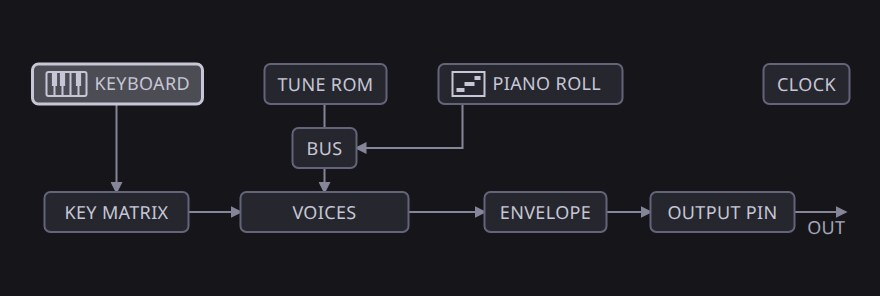
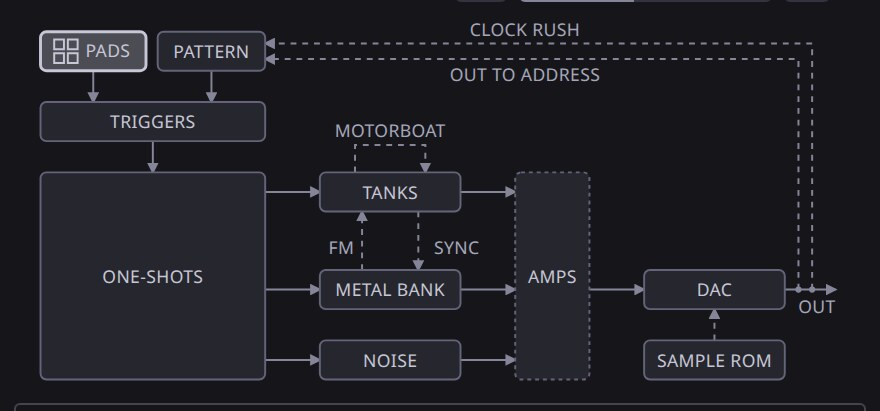
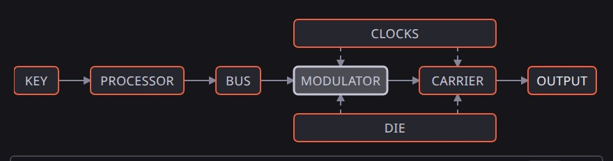
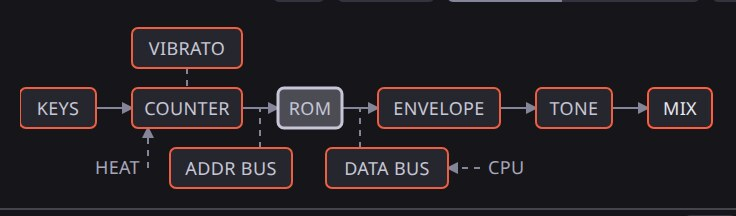
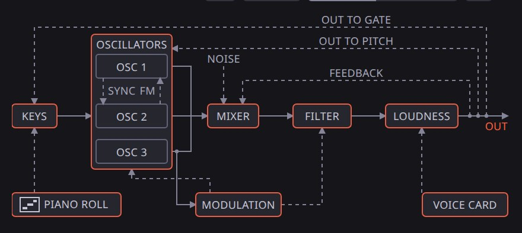
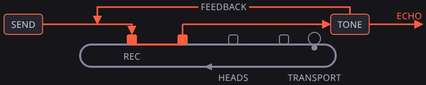
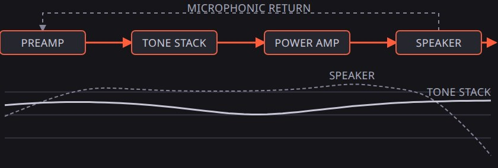
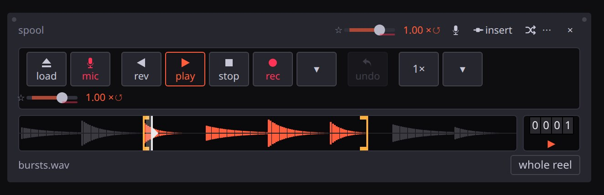
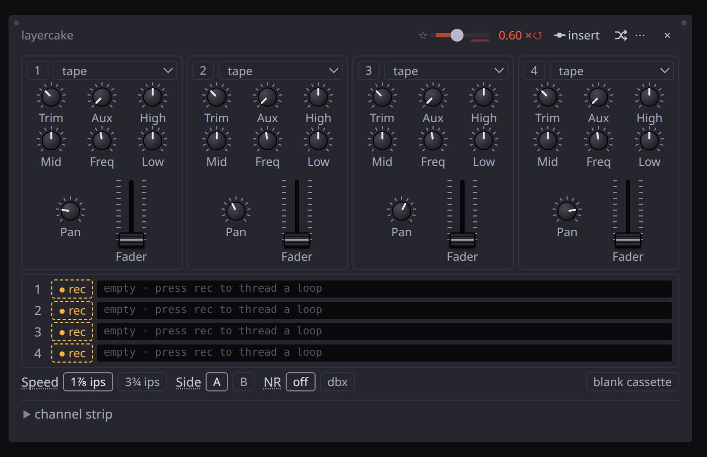

# bender

A circuit bender in the browser, built on Web Audio's
[AudioWorklet](https://developer.mozilla.org/en-US/docs/Web/API/AudioWorklet).


- [App](https://cmdcolin.github.io/bender/app/)
- [Pocket](https://cmdcolin.github.io/bender/pocket/), for phones
- [Home](https://cmdcolin.github.io/bender/), with your saved voices
- [Blog](https://cmdcolin.github.io/bender/blog/)
- [Jam of the day](https://cmdcolin.github.io/bender/jam/)

Watch Claude Code play it:
[Letting an AI agent drive bender](https://cmdcolin.github.io/bender/blog/agent-drives-the-app/)

## Machines

Each title opens it in the app.

<table>
<tr><td width="50%" valign="top"><b><a href="https://cmdcolin.github.io/bender/app/">Plinky</a></b> — a toy keyboard<br><a href="https://cmdcolin.github.io/bender/app/"></a></td><td width="50%" valign="top"><b><a href="https://cmdcolin.github.io/bender/app/">Clatter</a></b> — a drum machine<br><a href="https://cmdcolin.github.io/bender/app/"></a></td></tr>
<tr><td width="50%" valign="top"><b><a href="https://cmdcolin.github.io/bender/app/#p=UHg&v=3">Glint</a></b> — an FM synth<br><a href="https://cmdcolin.github.io/bender/app/#p=UHg&v=3"></a></td><td width="50%" valign="top"><b><a href="https://cmdcolin.github.io/bender/app/#p=mgN4&v=3">Parlor</a></b> — a sampling keyboard<br><a href="https://cmdcolin.github.io/bender/app/#p=mgN4&v=3"></a></td></tr>
<tr><td width="50%" valign="top"><b><a href="https://cmdcolin.github.io/bender/app/#p=qQN4&v=3">Growler</a></b> — a bass synth<br><a href="https://cmdcolin.github.io/bender/app/#p=qQN4&v=3"></a></td><td width="50%" valign="top"><b>Prattle</b> — a speech chip that says what you type<br><br><b>Howler</b> — a lead synth</td></tr>
</table>

## Other sources

- **Sheet** — a steel sheet you hit
- **Bottle** — a glass bottle you tap
- **Chaos osc** — an oscillator that runs wild on its own
- **Mic** — your microphone

## Pedals

<table>
<tr><td width="50%" valign="top"><b><a href="https://cmdcolin.github.io/bender/app/#p=rgFk&v=3">Wraith</a></b> — tape echo<br><a href="https://cmdcolin.github.io/bender/app/#p=rgFk&v=3"></a></td><td width="50%" valign="top"><b><a href="https://cmdcolin.github.io/bender/app/#p=0ATIAQ&v=3">Ember</a></b> — tube amp<br><a href="https://cmdcolin.github.io/bender/app/#p=0ATIAQ&v=3"></a></td></tr>
</table>

- **Gnash** — distortion
- **Ricochet** — delay
- **Boing** — spring reverb
- **Chorale** — chorus

Also **Ring mod**, **Crusher**, **Comb**, **Octave**, **Codec** and others.

## Tape and samples

<table>
<tr><td width="50%" valign="top"><b><a href="https://cmdcolin.github.io/bender/app/#p=bsgBBvQDAPgK&v=3">Spool</a></b> — a tape loop you can record onto<br><a href="https://cmdcolin.github.io/bender/app/#p=bsgBBvQDAPgK&v=3"></a></td><td width="50%" valign="top"><b><a href="https://cmdcolin.github.io/bender/app/#p=igR4&v=3">Layercake</a></b> — a cassette four-track<br><a href="https://cmdcolin.github.io/bender/app/#p=igR4&v=3"></a></td></tr>
</table>

- Samples — any audio file, or old records and radio from archive.org

## Playing

- Sequencer — a piano roll and drum steps
- Patch bay — wire modulation onto the controls
- MIDI — plug in a controller
- Share — a link holds the whole board
- Presets — boards to start from
- Agent — Claude Code plays it
  ([blog post](https://cmdcolin.github.io/bender/blog/agent-drives-the-app/))

## Run

```sh
pnpm install
pnpm dev
```

Then open http://localhost:4321/bender/app/.

## Docs

- [User guide](docs/USER-GUIDE.md)
- [Features](docs/features.md) — every control
- [Bends](docs/BENDS.md)
- [How it works](docs/HOW-IT-WORKS.md)
- [MIDI](docs/MIDI.md)
- [AI usage](docs/AI-USAGE.md)
- [Development](docs/DEVELOPMENT.md)

## Credits

Started from a Claude Fable template and extensively vibecoded. See also
[videoskillet.com](https://videoskillet.com).
