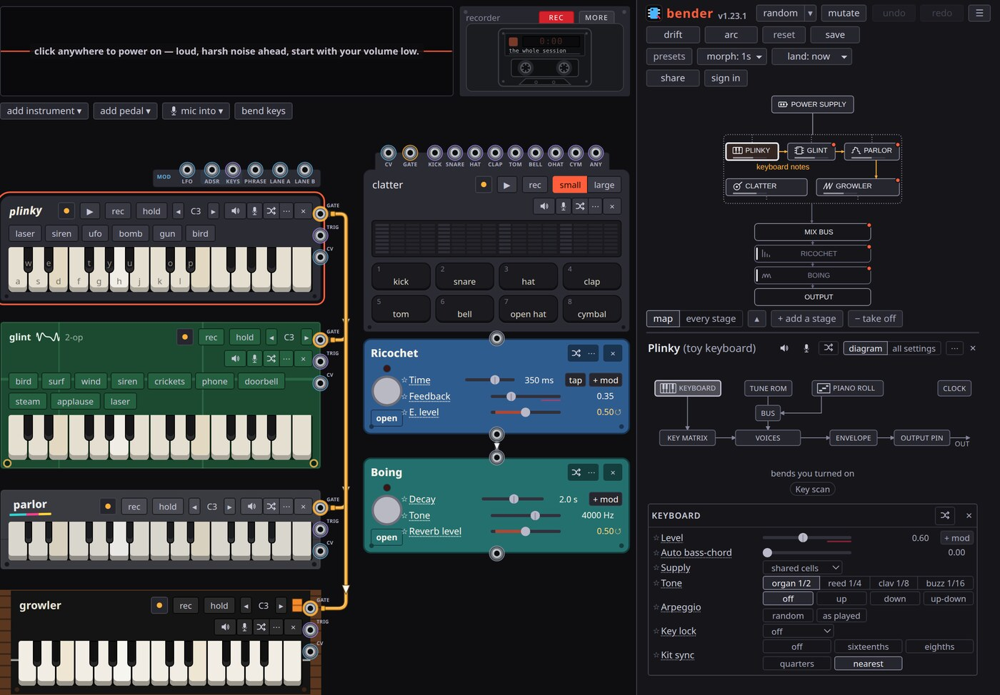

# bender

A circuit bender in the browser, built on Web Audio's
[AudioWorklet](https://developer.mozilla.org/en-US/docs/Web/API/AudioWorklet).



- [App](https://cmdcolin.github.io/bender/app/)
- [Pocket](https://cmdcolin.github.io/bender/pocket/), for phones
- [Home](https://cmdcolin.github.io/bender/), with your saved voices
- [Blog](https://cmdcolin.github.io/bender/blog/)
- [Jam of the day](https://cmdcolin.github.io/bender/jam/)

Watch Claude Code play it:
[Letting an AI agent drive bender](https://cmdcolin.github.io/bender/blog/agent-drives-the-app/)

Names in bold below are what each part is called in the app.

## Machines

Every machine is modelled down to its chips, buses and power rail, so a bend is
a real hardware fault: a paperclip on the clock pin, a solder blob on a bus
wire, a pot soldered onto the die.

- **Plinky** — a toy keyboard chip on a battery
- **Clatter** — a toy drum box with a sample ROM
- **Glint** — a two-operator FM chip
- **Parlor** — an eight-bit sampling keyboard
- **Prattle** — a talking toy's speech chip
- **Growler** — a Model D-style monosynth
- **Howler** — Growler's card voiced as a lead

## Other sources

- **Sheet** — a steel sheet with two contact mics
- **Bottle** — a glass bottle with a contact mic
- **Chaos osc** — two oscillators starving one supply
- **Mic** — a live mic, patchable into a clock pin or bus

## Pedals

- **Gnash** — distortion
- **Wraith** — tape delay
- **Ricochet** — delay
- **Boing** — spring reverb
- **Chorale** — chorus and ensemble
- **Ember** — tube amp

Plus a ring mod, crusher, comb, octave, codec and more.

## Tape and samples

- **Spool** — a tape loop that records over itself
- **Layercake** — a cassette four-track with four tape loops
- Samples — Spool loads any audio file, or 78s, numbers stations, NASA comms and
  old-time radio off archive.org

## Playing

- Sequencer — a piano roll and drum steps
- Patch bay — LFOs and other modulation on any control
- MIDI — plays the keys and turns the knobs
- Share — a link holds the whole board
- Agentic — Claude Code plays it, see the
  [blog post](https://cmdcolin.github.io/bender/blog/agent-drives-the-app/)

## Run

```sh
pnpm install
pnpm dev
```

Then open http://localhost:4321/bender/app/.

## Docs

- [User guide](docs/USER-GUIDE.md)
- [Features](docs/features.md) — every control
- [Bends](docs/BENDS.md)
- [How it works](docs/HOW-IT-WORKS.md)
- [MIDI](docs/MIDI.md)
- [AI usage](docs/AI-USAGE.md)
- [Development](docs/DEVELOPMENT.md)

## Credits

Started from a Claude Fable template and extensively vibecoded. See also
[videoskillet.com](https://videoskillet.com).
