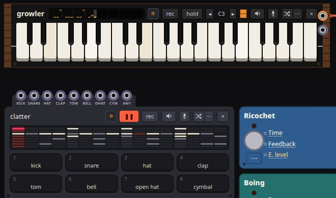

# Techno with an AI agent

Claude Code builds a techno groove in bender from plain-word requests, then
warps it with circuit bends: a starved supply, a slipping drum clock, a faulted
pattern bus and a dying bass synth.

- **In:** tell Claude Code to open https://cmdcolin.github.io/bender/app/ in
  Chrome and run `bender.help` in it, then ask for a techno groove
- **Out:** four on the floor with closed and open hi-hats and a rolling
  bassline, bent until it sags, limps and drifts, and a link to send



`bender.help` is the first page of `window.bender`, the app's scripting API.
Claude reads it and the guide topics it lists, then writes the groove with
JavaScript calls into the page. Each section below quotes one request, the calls
Claude made and what `bender.listen` reported. The quotes come from one
conversation with Claude Sonnet. Your run writes different notes, because Claude
composes them.

## Set up

1. Give Claude Code a browser, once:

   ```sh
   claude mcp add chrome-devtools -- npx -y chrome-devtools-mcp@latest
   ```

2. Start `claude` and paste the first request below. Claude opens Chrome on the
   app by itself.
3. If audio stays off, click the page. Browsers keep audio off until a page gets
   a click, and `bender.start()` tells Claude when that is the holdup.

[AI usage](AI-USAGE.md) covers the same steps with the Claude in Chrome
extension.

## 1. Lay down the groove

```text
Open https://cmdcolin.github.io/bender/app/ in the browser. It is bender, a
circuit-bent synth with a scripting API on window.bender; evaluate bender.help
with JavaScript first. Set up a classic techno groove: four on the floor, open
and closed hi-hats, and a rolling bassline. Start it playing and tell me what
bender.listen hears.
```

```js
bender.drums({
  bpm: 130,
  kick: 'x...x...x...x...',
  hat: 'xx.xxx.xxx.xxx.x',
  'open hat': '..x...x...x...x.',
  clap: '....x.......x...',
})
bender.line('. A3 A3 A4 . A3 A3 A3 . A3 A3 A4 . A3 C4 A3', {
  accent: '.x..x..x..x..x..',
})
bender.play()
```

- **Drum rows:** each character is a sixteenth. The open hat sits on the
  offbeat, and the closed hat on the next step cuts it short, because the two
  share one cap.
- **The bassline:** `bender.line` writes Growler's memory and steps it with the
  kit. Growler's stock 32′ range sounds each note two octaves down, and
  `bender.line` reports the sounding range:
  `sounds: "A1 to A2, at Growler's 32′ osc 1 range"`.
- **Demo songs:** `bender.play()` starts the kit and the bassline and leaves the
  toy's demo songs off.

The `techno` and `acid techno` presets load the same kind of groove in one call,
`bender.load('techno')`.

## 2. Starve the batteries

```text
Now bend it. Starve the batteries so the whole groove sags and the bass drags
flat, but stop short of the chip rebooting. Tell me the rail voltage you
measured.
```

Claude found `chipBattery` with `bender.find`, then stepped it and measured the
rail after each step:

```js
for (const v of [0.4, 0.6, 0.75]) {
  bender.set({ chipBattery: v })
  const l = await bender.listen(2500)
  // l.rail, l.reboots
}
```

Claude stopped with the rail at 0.37 of a fresh 4.5 V and no reboots. The kit
and Growler share that rail, so the tempo slows and the bass goes flat together.

## 3. Bend the drum machine

```text
Bend the drum machine's insides: make its clock slip so the bar limps, and put
a fault on its pattern bus so the hats come out wrong.
```

```js
bender.set({ drumSlip: 0.3, drumDataLine: 'D2', drumDataFault: 'to +V' })
```

- **`drumSlip`:** a slow clock edge leaves the step counter behind, so a step
  plays twice and the bar grows.
- **`drumDataLine`:** D2 is the hat's wire on the pattern bus. Tied to +V, the
  hat fires on every step the counter fetches.

## 4. Roll dice on the pattern

```text
Make the drum pattern rewrite itself every bar, so it never quite repeats.
```

Claude cleared the bus fault and put dice on the hats, clap and toms: a `?` step
fires with probability `drumChance`, rolled fresh each lap.

```js
bender.set({ drumDataLine: 'off', drumChance: 0.6 })
bender.drums({
  hat: 'x?xx?x?xx?x?xx?',
  'open hat': '..?...?...?...??',
  tom: '?..?..?...?.?...',
})
```

bender also has a bend made for this request: `drumLoop` ties the pattern
memory's output back to its input, so the pattern rewrites itself a lap at a
time. Ask for it by name, such as "set drumLoop to return a step late".

## 5. Break the bass synth

```text
Break the bass synth's voice card: let it drift out of tune, sag and droop like
a dying analog synth, and give it an acid edge.
```

```js
bender.set({
  monoDrift: 14,
  monoSag: 0.7,
  monoTune2: 0.35,
  monoTune3: -0.3,
  monoCutoff: 180,
  monoEmph: 0.85,
  monoContour: 4,
  monoDrive: 2.4,
})
bender.line('. A3 A3 A4 . A3 A3 A3 . A3 A3 A4 . A3 C4 A3', {
  accent: '.x..x..x..x..x..',
  slide: '..x.....x....x..',
})
```

The voice card has three more faults to ask for by name: `monoHeat` lets the
oscillators drift apart, `monoDroop` sinks a held note, and `monoDacBit` sends
some keys up by a stuck bit's weight.

## 6. Collapse the fourth bar

```text
Make the fourth bar of every four collapse: drop the kick and brake the whole
board at the end of it.
```

```js
bender.drums({
  'kick bars': '!4:4',
  event: '............bbbb',
  'event every': '4:4',
})
```

`!4:4` plays the kick on every bar but the fourth. The `b` steps brake the board
like a tape stop, and `event every` fires them on the fourth bar alone.

## 7. Send it to a friend

```text
Give me a link to this so I can send it to a friend.
```

`bender.link()` returns a `#set=` URL holding every changed control, the bends
included. A friend who opens it gets a **▶ click to start** button, which starts
the kit and the bassline and leaves the toy's demo song off.

## What Claude can't check

`bender.listen` reports the peak, the supply rail, reboots, the sources with
signal, the notes each audible machine played and the drum voices hit.

- **Timbre:** no reading covers a squelch, a slip or a drift, so Claude checks
  the controls it set and leaves the sound to your ears.
- **Bar position:** `listen` lists which voices hit, not the bar each landed in.
- **Glides:** `set` with seconds returns at once. Start a glide in one call and
  listen in the next, since one call held across a long glide can time out.

## By hand

- **presets → techno** or **acid techno**, then space, gives the groove.
- **Power supply → Batteries** and **Starve** sag the rail.
- **Clatter's panel** holds Clock slip, the pattern bus and Pattern loop.
- **Growler's voice card** box draws each fault on its part.
