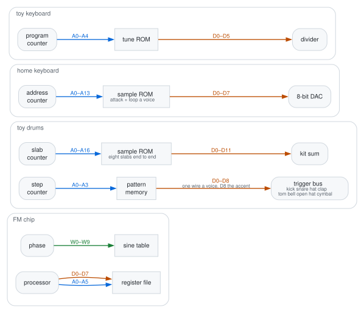

# Bends

Every bend models a real hardware fault. A clock bend changes the toy's pitch,
tempo and envelopes together, because one RC oscillator feeds the divider for
all three.

## Where the buses run

The drawing shows the two blocks each bus joins and its width; the source is
[buses.dot](img/buses.dot).

- **Address bus:** a knife fetches the wrong thing, and the chip plays it
  perfectly at the same tempo.
- **Data bus:** a knife mangles a correct fetch.
- **Glint:** both buses run into the register file, so a fault stays until the
  processor rewrites that register.
- **Wire numbers:** on the drum data bus one wire is one voice, in row order. On
  Parlor's, one wire is one bit of the sample word.
- **Toy and FM data lines:** the toy line holds a note code and the FM line
  holds whichever byte the processor sent, so find useful wires by trying them.
- **Named cuts:** each cut under _knife on the bus_ saves one wire and fault
  worth keeping.
- **Panel drawing:** each chip's bus box (**pattern** on the drum machine) draws
  one trace per bit, lowest on top.
  - Knife rows, named cuts and drawing show while the box is open, and a knifed
    board opens it.
  - A cut turns the box's wire and the trace red, and the trace shows its line
    name.
  - A slash marks a cut, dotted while **Cut depth** leaves it conducting. A
    ground symbol or +V bar marks a short to a rail, and a solder blob marks a
    bridged pair.
  - The toy's loop wire, the drum kit's counter reset, the kit's clock and
    Glint's strobe each get a wire that turns red once the knob is up.
- **Toy on bus:** draws the toy's output soldered across Glint's lowest data
  lines, with a dot on each line reached.

## The shared power rail

The Power supply panel draws one rail from the cells to the machines. The cells
box opens first, then the reset chip and clip boxes.

- **Starve:** a resistor to ground that sags the rail the toy keyboard, drum
  machine and FM chip share.
  - A quarter up, the toy runs flat and dives.
  - At three-quarters, the watchdog resets the chip several times a second and
    the tune restarts where it was.
  - Resets hold 40 to 130 ms and the trip point drifts with heat, so reboots
    come irregularly.
  - The lamp above the keys shows the rail voltage (4.5 V fresh) and **reboot**
    when the watchdog fires.
- **Reservoir:** capacitance behind the supply. Stock, a dive is instant (under
  1 ms). Wound up, pitch sweeps down over 17 ms to 2 s, taking tempo and
  envelopes along.
- **Clip chatter:** a paperclip dragged across the supply pads. The rail dips in
  irregular clusters of a few tens of ms and recovers at the Reservoir rate.
- **Clip on clock:** a paperclip on the oscillator pin. Pitch, tempo and
  envelopes drop up to four octaves at the top of the knob, where Starve alone
  stops near two-thirds of an octave. Pitch falls slowly and returns instantly
  when the clip lifts.
- **Latch-up:** a brownout that does not reboot. The held note screams and dives
  for up to a second until the watchdog power-cycles the chip, and a heated toy
  latches more readily.
- **Crystal drift:** the toy's clock wanders off its ratio to the drum machine,
  swinging apart, back close and apart again.
- **Kit sync** and **Arp sync:** take the tune's and arpeggio's rates from the
  kit's beat, so every bend here still drags them. Arp sync on sixty-fourths
  trills at 120 bpm; a clock pot turned up on it buzzes at the strike rate, up
  to 800 Hz.
- **Junk in the counter:** after a brownout the program counter holds whatever
  its latch had, so the tune resumes mid-song as often as from the top.
- **Batteries:** flat cells have lower resting voltage and more internal
  resistance, so pitch, tempo and every envelope run low and stretch together.
- **Lead resistance:** a series resistor that drops voltage only under load. The
  rail sags on each attack and recovers between hits, so the toy whoops on every
  note and never runs low.
- **Bend spot + pot:** solders a virtual pot onto the die at the clock, the
  counter (scrambles the melody), the DAC bias or the gate line.
- **Output stages:** the four keyboard voices have separate output stages on
  this rail, so a starved chord collapses raggedly. See **Part spread** under
  [the parts rack](#the-parts-rack) below.

## The toy chip's pins

The Plinky panel draws the parts these bends reach, and a bend turns its part or
wire red.

- **Keyboard box:** top left, opens first, with the playing rows for tune,
  level, tone, accompaniment, arpeggio and key lock.
- **_clk_ tags:** mark each part the clock reaches and open the clock when
  pressed. The envelope's tag reads _PWM_ and the output pin's reads _scan_
  while those bends are on.
- **Bend spot** and **Bend pot:** the clock, tune ROM, envelope and output pin
  boxes open both rows. The pot hangs off its part, and pressing it opens that
  box.
- **Red feedback wires:**
  - **Step tap** runs from the voices to the tune ROM.
  - **PWM tap** runs from the voices to the envelope, and the envelope's tag
    goes back to _clk_.
  - **Envelope on divider** runs from the envelope to the voices.
  - **Envelope relax** loops over the envelope.
  - **Output on address** and **Output on data** light the tune ROM.
  - **Crosstalk** runs from the output to the clock.

Bends:

- **Crosstalk:** the output trace runs beside the timing pin, so the chip's
  sound frequency-modulates its clock, tempo and envelopes.
  - A lone note stays periodic, brightens and climbs in pitch.
  - A chord cross-modulates, and past halfway it measures as noise.
  - A decaying note sweeps its timbre.
- **Scan:** all ten voices (melody, bass, three chord notes, four keys, effect
  button) share one output pin, and a scan counter connects each sounding voice
  in turn at the chip clock rate.
  - A lone note holds the pin.
  - Low on the knob, a chord buzzes at the scan rate.
  - Around three quarters, a chord flutters.
  - At the top, a held chord arpeggiates, about six notes a second.
- **Loop wire:** a jumper from one note-latch pin back to the ROM.
  - **Onto an address pin:** the pair bridge and the low one wins, so the song
    takes a new path through the ROM, the same every lap.
  - **Onto reset:** each rising edge of that bit sends the counter to step zero,
    so the song loops the stretch before the bit first rises. On _für elise_ D1
    loops seven steps and D4 sixteen.
- **Song line:** a knife on the five wires that pick the song. The tune keeps
  its tempo and length and plays another song's notes. A wire already matching
  the fault changes nothing: _für elise_ is song 4, so S2 held high leaves it
  alone and S0 held high plays _ode to joy_.
- **Divider line:** a knife on the twelve-bit word each note loads into its
  pitch divider (A3 loads 512).
  - A low wire nudges the top of the keyboard.
  - A high wire moves notes by octaves: N8 held high turns 512 into 768, two
    thirds of the pitch.
  - A held note keeps its pitch until the next note loads.
- **Volume PWM:** the knob taps the carrier from 20 kHz down ten octaves,
  whining under every note, and a fade changes the tone.
- **Envelope cap:** swaps the capacitor each envelope runs on.
  - **Reversed:** each note is silent at the strike, swells to full, then cuts
    off.
  - **Leaky:** the cap stops draining below 0.3, so notes drone until a rest, a
    new note or a voice steal. Four held-and-released keys pile into a
    four-voice drone.
- **Voice short:** solders every voice output onto one node where the lowest
  driver wins, so a chord intermodulates into a buzz. The knob crossfades the
  mix into the short.
- **Ghost keys:** lifts the diodes off the key matrix. Two held keys in
  different rows and columns close the other two corners of their rectangle, and
  those sound as held keys. Four columns wide, A3 and F#4 add A#3 and F4.
- **Step tap:** clocks the tune's counter off a stage of the melody's pitch
  divider.
  - High notes rush and low notes linger, and a rest keeps the last note's rate.
  - The knob moves the wire from the ninth stage to the first. At the top the
    tune steps over a hundred times a second and plays as one buzzing tone.
- **Envelope relax:** a leak and a trigger across the envelope cap. The leak
  drains up to seven octaves faster and the trigger recharges the cap at a
  quarter, so each note restrikes until a rest, a new note or a voice steal.
  Notes stutter low on the knob and buzz around 200 Hz at the top.
- **Envelope on divider:** pitch falls up to three octaves as the envelope
  fades, so every note, bass, chord and key becomes a zap.
- **Output on address:** solders the output pin onto one ROM address line, A0 to
  A4. The ROM serves one of two neighbouring steps as the pin swings, and the
  divider loads whichever note returns without restriking it. A rest on one side
  gates the note at its pitch.
- **Output on data:** solders the output pin onto one note-code wire, D0 to D5.
  The melody flips at audio rate between its note and one a fixed interval away:
  D0 a semitone, D2 a major third, D3 eight semitones, D5 about two and a half
  octaves. A rest or hold on the other side gates it.
- **PWM tap:** takes the Volume PWM carrier from the melody's pitch divider, one
  octave under the note at the bottom of the knob and six at the top. A fading
  note grows a sub-octave growl, and chords and keys chop at the melody's rate.
- **FM on clock:** wires the FM chip's output onto the toy's timing pin through
  the Crosstalk coupling, bending pitch, tempo and envelopes up to four octaves.
  - The toy receives Glint's output 2.7 ms late.
  - Glint plays the toy's notes, so each chip's timing moves the other's notes.
  - With **Toy on bus** up too, Glint's sound bends what the toy writes next.
  - It does nothing while Glint is down.
- **Output hold:** a latch strobed off the melody's pitch divider holds the
  output level between strobes.
  - Bottom of the knob, the strobe runs five octaves over the note and the sound
    turns gritty.
  - At the top it runs three octaves under, and each note becomes a coarse
    staircase.
  - Step tap, the clock pot and Crosstalk move the strobe with the tune.
  - Output on address and Output on data flip at the strobe rate.
- **Hard sync:** a free oscillator, 30 Hz at the bottom of the knob and four and
  a half octaves up at the top, resets every voice's divider each cycle.
  - A note above the oscillator sounds at the oscillator's pitch with a
    note-dependent edge.
  - Sweeping the knob across a held note produces the hard-sync scream.
  - A note below the oscillator falls silent, so the bass drops out first.
  - The oscillator follows the chip clock.
- **Voice XOR:** multiplies the mix by the sign of every sounding voice but the
  first. A chord becomes sum and difference tones, a ring-modulated clang. The
  knob crossfades the mix into the XOR.
- **Envelope bits:** a fade runs in steps, 32 at the bottom of the knob and one
  at the top, where a note is a gate that cuts at half. With Volume PWM up, each
  step is a different tone.
- **Duty on envelope:** a note strikes as a 4% spike and opens to the tone
  selector's width as it fades.
- **Effect buttons:** six programs for a sweep counter that loads the melody's
  divider, plus a noise register for bomb and gun.
  - Clock, a flat battery and a pot on the timing pin lower and stretch each
    effect together.
  - The divider knife, tone selector, Volume PWM, envelope bits and duty on
    envelope reach the effect voice too.
  - The sweep loads whole divider words, so laser and bird climb in steps near
    the top.
- **Effect wire:** solders the effect buttons to a kit trigger line, the toy's
  gate (every note, the tune included), the reset line, or holds one stuck down.
  - **Button it presses** picks the effect: one of the six, random, or the next
    one along.
  - A hat wired to gun is a machine gun in time with the pattern.
  - Reboot with a starved rail fires an effect every time the chip resets.

## Glint's register bus

A register keeps the last value the processor wrote, so a fault stays until a
write touches that register again.

- **Wire faults:** any bus wire can be forced **to ground**, forced **to +V**,
  **bridged** to its neighbour (the driver pulling low wins) or **cut**.
  - A cut wire floats, holds the last bus value for a word or two, then follows
    its neighbour's edges a lap behind. It is the only fault that drifts.
- **Cut depth:** how far the knife went. At partial depth the wire conducts some
  of the time, and the melody flickers between the version sent and the version
  the wire drifted to.
- **Data line:** the key-up bit held high never ends the note, and held low the
  chip plays nothing.
  - The frequency's top bit shares a byte with key-on, so a fault there moves
    pitch and whether the note sounds.
  - A stuck bit in the volume nibble leaves one of the four voices at the wrong
    level for good.
- **Address line:** the byte arrives intact and the chip writes it to the wrong
  register.
- **Slip the strobe:** the chip sometimes misses the pulse that latches a write,
  so the value commits to the register the last latched pulse named, one write
  late.
  - Two misses lag two writes. Wound all the way over, the chip never advances
    past the first register it latched.
  - Effects fire hundreds of writes a second, so a chirping cricket becomes one
    continuous drone.
- **Cut the wave ROM:** cuts the address wires of the 256-entry sine table. The
  next read after release is clean.
  - **Wave line** (address): holding the mirror bit runs the quarter-wave twice,
    giving a sawtooth edge and an extra octave. Holding the sign bit reads only
    the top half, giving an all-octave rectified tone. Low wires are nearly
    inaudible.
  - **Wave data line** (data): cuts a step into the amplitude at one bit
    position, with no change in pitch. The top pin held high keeps every sample
    at half scale or more, and parted it sounds like gravel.
- **Noise blob:** a solder bridge from the percussion shift register's output
  onto the table's eight pins, filling from the least significant up. A touch
  adds dirt to the note, and all the way across the output is the carrier's
  square gated by the register. It applies on every patch, under an effect and
  through a panic.
- **Patch line** and **Patch data line:** cut the patch table, sixteen rows of
  eight bytes. Row 0 is the register file, and rows 1 to 15 are the die's bank.
  - Byte lines P0 to P2: P0 to ground reads each even byte twice, so the carrier
    gets the modulator's settings.
  - Row lines P3 to P6: held at +V they put every channel on one of the die's
    patches. The processor only asks for row 0, so other row-line faults need a
    data-line knife to pick another row.
  - Data lines: each moves one bit in all eight bytes. B0 drops the note an
    octave, and B5 is the hold bit, so a struck voice rings while the key is
    down.
- **The hidden test register:** the driver clears it with every patch change. A
  **Data line** fault on that write sets bits no legal patch sets:
  - Every operator forced wide open turns envelopes into a plain gate.
  - The envelope counter at its fastest step collapses every note to the same
    four-millisecond click.
  - The output latch skips every other slot, halving the sample rate with full
    aliasing.
  - The latch's sign line held rectifies the output.
- **Rhythm:** gives the top two channels to the percussion bank. Every note
  strikes the bass drum, an octave under the bottom of the keyboard. **Kit voice
  that plays this chip** clips on the trigger lines the snare and hi-hat need.
  - Hi-hat: every shift register bit, like sand. Snare: one bit in eight, held,
    like a rattle with a body under it.
  - A frequency-register wire sets the hiss coarseness: low is a rumble, high is
    sand.
  - A wire held low disables the rhythm button. Held high, a drum never lifts.
  - A wire held high on the "no drums" byte switches the bank on with no button
    press, and the melody reaches the die as strikes. Patch-byte knives cannot
    reach the kit's rates.
  - An effect uses the same two channels, so each turns the other off.
- **Vibrato:** the flag bits that wire an operator to the die's single LFO,
  tremolo at the top bit and vibrato below it. The button takes a patch write to
  apply, so a knife can leave it down with nothing wobbling. Tremolo is hard to
  hear with both operators wired, so switch the modulator off to hear it.
- **Key scaling:** two bits at the top of each of two level bytes make a patch
  lose level the higher it plays. A fourth bit shortens envelopes at the top of
  the keyboard.
- **The instrument nibble:** the high nibble of each channel's volume register
  picks the patch. 0 reads the register file, and 1 to 15 are patches burned
  into the die. The case has buttons for eight. The other seven are a violin,
  flute, oboe, trumpet, horn, harpsichord and vibraphone. A wire held high makes
  one channel read ROM mid-note while the others play what you asked for.
- **The effect ROM:** bird call, surf, wind, siren, crickets, phone, doorbell,
  steam train, applause and laser, each a processor program firing hundreds of
  register writes a second.
  - **Data line** scales with the traffic, so every write comes out wrong. Under
    **Cut** the drifting bit follows the effect's motion.
  - An effect borrows the whole patch and a fourth voice, so the keyboard drops
    to three voices.
  - With the rail starved, the chip dives and slurs while the effect keeps its
    rate.
  - **phone:** a bell struck twenty times a second in a double ring. The key
    wire held high makes one held tone.
  - **steam:** the one script that rewrites a patch byte, writing the feedback
    to zero for a whistle.
  - **applause:** noise struck up to seventy times a second. Through a 9-bit
    **Log adder** it is white noise.
  - **laser:** a note dropping six octaves in a sixth of a second, three shots a
    burst.
- **Effect wire:** the same wire as the toy's, onto Glint's effect buttons. Each
  press restarts the script from the top.
  - **Press length** sets how long a press holds the button, since the scripts
    loop. Short presses on a hat turn a bird call into chirps on the beat.
  - Stuck on random or next picks a new script each time Press length runs out.
- **Clock:** the chip's crystal. Pitch, envelope rates, LFO and shift register
  count off it, so turning it down transposes the chip without changing timbre.
  **lock** sets it to the toy's crystal.
- **CPU clock:** the processor's crystal. Note length and the effect scripts
  count off it, so a slow one holds notes longer and slows a bird call while the
  chip stays in tune. At 16× crickets comes out close to noise.
- **FM clock** and **FM CPU clock:** bay lanes for the two clocks, three octaves
  at a full push.
- **DAC slot** and **Slot slip:** the four channels share one converter, and a
  counter picks the slot each sample.
  - Stuck: only notes assigned to that slot sound, one voice four times as loud.
    **FM DAC slot** walks the slots through a chord.
  - Slipping: the counter sometimes reads a channel twice and skips the next. A
    touch is a flutter, the middle a buzz pitched by the slip rate, and the top
    folds notes into images a quarter of the sample rate apart.
- **Allocator:** the driver's channel picker. Stuck, every note goes to one
  channel, each note cuts off the last one's tail, and a chord comes out as its
  last note.
  - Stuck on 3 with **Rhythm** on: the tune retunes and strikes the bass drum.
  - Stuck on 4 with **Rhythm** on: the notes play on the snare and hi-hat
    channel, where frequency sets the shift register's gate rate.
  - Stuck on 4 with an effect running: the song fights the script for the
    channel.
- **Cold boot:** the register file at power-on. On **garbage** the chip comes up
  holding random bytes, fresh on every switch-on and every panic.
  - A channel that boots with its key bit set drones at a random pitch and
    instrument until a note plays on it.
  - On the first boot, A0 to ground leaves the test register wide open, skewed
    and rectified.
  - A wire on **FM cold boot** power-cycles the chip each time it crosses
    halfway, so a square LFO on it stutters random chords.
- **Log adder:** replaces the multiplier with the real die's arithmetic. Any
  width switches every operator to a wrapping adder of that many bits, and
  envelopes and levels add as attenuation.
  - A decay that passes the adder's top returns at full scale, every 48 dB at 11
    bits and every 3 dB at 7.
  - A narrow adder folds the quiet middle of each sine into a harsh buzz at the
    note's pitch.
- **Toy on bus:** solders the toy keyboard's output onto the low data bits,
  loudest toy bit on the lowest wire. The control counts bits, 1 to 8, and the
  toy must be sounding. The damage builds as the toy plays.
  - The register is usually a key register, whose low bits are the pitch's top
    bit, then the octave, then the key. One bit jumps the pitch at the toy's
    rate, four throw the note between octaves and five key it on and off.
  - At eight bits the register follows the toy's waveform and Glint comes out
    close to noise.

## Inside the drum voices

The pads box at top left of the Clatter panel opens first and holds level,
tempo, swing, chance, tune, decay and mute.

- **Ring:** the fraction of each swing a bridged-T network (kick, tom, snare
  body) gives back.
  - Under about nine tenths of the travel the voice stays a drum.
  - At the crossing it rings forever.
  - Past the crossing it grows into clipping and becomes a note the pattern
    retunes.
- **Sweep:** the bias trimmer behind the pitch swoop, as a multiple of the
  shipped value.
  - 8 starts a kick several octaves up and falls like a Syndrum zap.
  - Below 0 the kick starts low and rises, down to three octaves under resting
    pitch.
- **Bank FM:** the metal bank's squarer shakes the kick, tom and snare tuning.
  - A little makes a kick metallic.
  - Past about a third of the travel the kick becomes a quieter, brighter clang,
    centroid near 500 Hz against 67 Hz stock.
- **Bank sync:** resets all six metal oscillators each time the kick or tom
  swings up through zero.
  - While the drum rings, the hats, cowbell and cymbal repeat at its pitch and
    fall with its swoop.
  - Every hat struck with a kick comes out the same hat.
- **Tank coupling:** the kick's network drives the tom, which rings about an
  octave up.
  - Past a quarter of the travel the tom answers louder than the kick.
- **Trigger pulse:** how long the one-shot holds the trigger down.
  - Narrow gives a click and a clean shock.
  - Wide gives no click and less body.
- **Pulse sharing:** all eight one-shots share a timing rail, so voices fired
  together steal charge and the swoop starts lower.
  - A kick struck with a hat and a clap starts at 75 Hz against 100 at the top.
- **Trigger load:** each one-shot drains the supply at the front of its hit.
  - At the top a kick drags a ringing cowbell or cymbal down an octave, back
    over about 60 ms. Kick, snare and hat together drag it nearly two.
  - The dip reaches the shared rail a block later, so Plinky goes flat under
    busy steps.
- **Snappy:** all the way up is the noise transistor alone. Lower, the two tuned
  networks come through and beat against each other, and Tune moves them.
- **Noise bias:** reverse bias on the one avalanche transistor behind the snare,
  both hats and the clap.
  - With plenty of bias it hisses steadily.
  - Toward the knee it latches in and out at random, holding each state between
    a third of a millisecond and a tenth of a second (popcorn noise).
  - All four voices break up together mid-hit, and near the bottom the kit
    spits.
- **Dice:** puts the kit's dice on the noise junction, which rolls while the
  junction conducts and holds its last answer otherwise.
  - A maybe step repeats its last answer 74% of the time at bias 0.5 against 51%
    free, and 97% at 0.3.
- **Clap gap:** the period of the clap's burst oscillator, 9 ms stock.
- **Clap bursts:** how many bursts fire before the clap rings out, three stock.
  - Under about 3 ms of gap the train becomes a noise buzz that needs dozens of
    bursts to last.
  - At a few hundred milliseconds each burst is a separate clap.
  - A sagging rail spreads the bursts into a flam.

## The metal bank

The cowbell, two hats and cymbal share six free-running square oscillators,
tuned so that no two share a harmonic.

- **Squarer bias:** backing off the comparator resistor makes the stage amplify,
  and the hats and cymbal become a metal chord. The bottom of the travel
  measures three times as tonal as the top. The cowbell is unaffected.
- **Metal:** blends the metal bank with the noise transistor on the hats'
  amplifier. Down is a noise hat with every hit the same, and up no two hits
  match.
- **Bank spread:** widens the bank without transposing it, on all four metal
  voices. The cowbell detunes, the cymbal turns glassy and the hats get
  grittier.
- **Bank starve:** slows all six together by up to three octaves.
  - The cowbell drops and its beat stretches.
  - The hats and cymbal thin to a crackle.
  - Kick, tom and snare stay at the Tune pitch.
- **Bank gate:** the six run only while the chosen voice sounds.
  - Gated on the kick, the metal voices sound only under a ringing kick.
  - Gated on a metal voice, each hit starts where the last stopped, so two hats
    in a row differ.
- **Cymbal tone:** a wiper between two taps on the cymbal's filter. Down keeps
  the body the hats throw away, and up approaches a hat.
- **Choke:** the hat and open hat share a pedal cap, and a closed step drains a
  ringing open hat. Choke moves the draining resistor.
  - _Kick cuts the kit_ drains everything.
  - _Each cuts the next_ passes the choke round the ring.
  - The hat pair stays hard-wired.
- **Accent sag:** how much each accented step takes off the one accent cap that
  feeds every voice.
  - At 0 every accent is full.
  - Wound up, a step stacking four voices gives each less than a step stacking
    one.

## Parlor's sample bus

A counter walks a ROM of one attack and loop per voice into a DAC. A knife
reaches the counter and the data.

- **Address line:** 14 counter wires into the memory. Every word is real but
  from the wrong place, and pitch holds.
  - A low wire held down reads each word more than once, so the voice drops an
    octave and coarsens.
  - A high wire folds the recording onto a fixed half, so a voice loops inside
    its attack.
  - The top two wires are never driven high on any voice but _sampled_.
- **Data line:** the sample comes back wrong on every word, so pitch holds and
  the surface changes.
  - D7 held high folds the bottom half of each wave onto the top, and a string
    pad becomes a rectified buzz.
  - Lower wires punch a notch through each word, which sounds as gravel.
  - A bridge puts the words on a lattice and the wave in steps.
- _Tone:_ the two-pole filter against the images over every voice, since the ROM
  was cut at 9.9 kHz with no interpolation.
- _ROM clock:_ drags the counter, so pitch and aliasing move together.

## Growler's voice card

Seven voice-card parts fail the way analog synth parts do. The drawing under the
**voice card** box shows each fault as a red reading on its part.

- **Hot converter:** the exponential converter's transistor pair with no heater.
  The three oscillators drift apart and octave widths stretch. Low notes stay
  near in tune and high notes disagree.
- **Leaky VCA:** the amplifier stays slightly open, so the oscillators drone
  under and between notes.
- **Contour caps:** bigger timing capacitors stretch every attack, decay and
  release by one factor. A pluck becomes a swell.
- **Mismatched pair:** one ladder transistor pair sits up to three times off the
  cutoff of the other three stages. The resonant peak moves and widens, and the
  self-oscillation pitch shifts off the cutoff.
- **Pitch droop:** the pitch-hold capacitor leaks toward 0 V. A held note sinks,
  faster the higher it started, and each new key resets it.
- **Key DAC bit:** holds one bit of the key converter high. Keys with that bit
  set play as written, and every other key jumps up by the bit's weight in
  semitones.
- **Sag:** a weak regulator. Loud notes dip the pitch and close the filter on
  each hit, and both recover as the note fades. **Starve** and a brownout also
  drag the pitch, since the card shares the toy's rail.

## The drum machine's pattern bus

The bus runs between the step counter and the pattern memory. The four wire
faults (to ground, to +V, bridged, cut) change which cell the memory answers
with.

- **Address line:** changes which step plays.
  - A0 held low files each odd step on the even one below it and halves the
    resolution.
  - A3 held high plays the back half of the bar.
- **Data line:** the trigger line itself, so other instruments on that line hear
  the change.
  - Forced high, that voice fires on every fetched step.
  - Forced low, the row shows and never sounds.
  - A bridged pair fires where both rows agree.
- **D8:** the ninth data wire, after the eight voices in grid order. D8 sets how
  hard a voice is struck.
  - Held high, the accent fires on every step, and with **Accent sag** wound up
    the kit pumps by how many voices each step strikes.
  - Held low, the accent row shows and never sounds.
  - Bridged to a neighbouring row, the accent fires where that row does, for
    example on crashes alone.

## The counter's own clock

- **Clock slip:** an edge on the step-counter clock too slow to cross the
  threshold leaves the counter behind. That step plays twice and the bar grows a
  step.
  - The pattern walks against the accent row and any row not sixteen steps long.
  - _Kit sync_ keeps the toy at the requested tempo while the kit slips.
  - At maximum the machine stays on one step at the step rate.
- **Counter reset:** a voice's trigger line soldered to the counter's
  synchronous clear. After that voice strikes, the next clock edge loads step
  one.
  - A snare on step five of the rock beat makes a five-step bar.
  - Rows of different lengths realign at each reset.
  - A maybe step on the reset voice rolls the bar length each lap.

- **Pattern loop:** the pattern memory's output tied back to its input, so the
  pattern rewrites itself a lap at a time.
  - _Return inverted_ plays every row's gaps every other bar.
  - _Return a step late_ slides every row one step later each bar, under a fixed
    accent row.
  - _Each row into the next_ passes each part down the grid a bar at a time,
    round to the kick after eight bars.
  - _Return through an XOR_ mixes each step with its neighbour. A sixteen-step
    row returns within 255 bars.
- **Scan:** time the chip takes to move from one voice to the next. Slowed, a
  multi-voice step becomes a flam in row order.

## The drum machine's sample ROM

The eight slabs sit end to end, kick first and cymbal last. **Sample ROM**
appears once the kit is sampled.

- **Slab counter:**
  - End stop cut: the counter runs through every later slab, so one kick hit
    plays about four seconds of the kit.
  - Up/down pin wired: the slab plays backwards, tail swelling into the attack.
  - Both: one cymbal hit plays the whole kit in reverse.
- **ROM address:** a wrong address often reads another voice's slab. A0 low
  reads each word twice. A16 high puts the kick's counter in the open hat's
  tail, then the cymbal's attack.
- **ROM data:** a twelve-bit word. D11, the top bit, folds each hit into a
  square-edged blat at about 1.7 times the level. The low wires are barely
  audible.
- **Cut depth:** shared with the pattern bus.

## The trigger patch's other faults

See [the trigger patch](USER-GUIDE.md#the-trigger-patch) for wiring.

- **Retrigger:** pulses the trigger line. Past roughly 40 Hz the retrigger
  period becomes pitch.
- **Trigger floor:** how far a voice must decay before its one-shot answers
  again. Zero strikes on every pulse; maximum waits for a full finish. The
  sequencer, pads, mic and keyboard all pass through it.
- **Ring trigger:** a comparator on one tank's ring, soldered onto other voices'
  trigger lines. It strikes once a cycle while the ring is loud.
  - _Kick fires hat_ rattles the hat at the kick's pitch and swoop.
  - _Kick fires itself_ drones around 100 Hz and never stops. **Trigger floor**
    lowers the drone and divides it out at maximum.
  - _Kick fires the kit_ strikes all seven other voices every cycle.
  - The sampled kit reads the slab's output.
- **Cross-patch:** bridges two voices' envelope pins, so one amplifier follows
  another voice's envelope.
- **Rotate:** cycles the cross-patch through the original three voices.
- **Whole kit:** extends the cross-patch to every voice, including voices with
  no steps.
- _Triggers and cross-patch_ fold: dashed red wires run from a choking trigger
  line to its voice, solid red from a ring-trigger voice to the lines it fires,
  and red from a cross-patched voice to the amp it drives.
- **Mic patch:** wires the mic past the mixer onto the chip's supply rail, the
  oscillator's FM input, the delay's feedback path, the ring modulator's
  carrier, or a drum machine or glitch buffer trigger line.
- **Restarts the file on:** puts a dropped audio file on a kit voice, any hit, a
  keyboard note or the mic.
  - **Ending** one-shot: the file plays as one more drum voice, retriggered on
    every hit.
  - **Ending** loop: each hit restarts the file.

## The patch bay and body pad

The patch bay is four free wires.

- **Sources:** the bay's LFO, the sag on the dying supply, the output envelope,
  the mic, a body pad axis, the feedback bus, the chip's sequencer ramp across
  each ROM step (locked to the tune), either box's trigger line, and board heat
  (slowest, never resets).
- **Destinations:** a filter cutoff, a carrier, a clock, the shift or
  word-length controls, tape speed or delay time, glitch chance, stompbox drive,
  the kit's trimmer, the spring tank's decay, the drum cross-patch amount, the
  feedback amount, or another wire's depth.
- **Starve:** the shared rail; one wire affects everything it powers.

- **Toy chip lanes (twelve):** **crosstalk**, **scan**, **PWM** and **short**
  move every sample. The envelope cap, ghost keys, loop wire and the song and
  divider knives step once a block. Drum hit onto scan chops a held chord into
  an arpeggio on every kick.
- **Toy feedback lanes:** **step tap**, **envelope relax**, **envelope on
  divider**, **PWM tap**, **FM on clock** and **hold** move every sample. The
  output's address and data lines step once a block, and **FM toy on bus** steps
  through the bit counts. An LFO onto envelope relax sweeps every note between a
  stutter and a buzz.

- **Kit lanes:** **tempo**, **swing**, **chance**, **decay** and **ring**. Drum
  hit onto chance lets fills feed themselves.
- **chaos:** bay oscillator shape that folds along a Rössler-style band and
  never repeats a point.
- **drunk:** bay oscillator shape, a bounded random walk that reflects off the
  ends.
- **Body pad:** two bare contacts; touching both makes your body resistance the
  control. It does nothing until a bay wire is soldered to it.

## Effects and pedals

- **Brake + supply drag:** the tape delay's capstan as a weighted motor. Echoes
  sag on the way down and spin up on release; wired to the supply, repeats dive
  when power fails.
- **Ring:** a multiplier in the tape delay's regeneration, so every repeat
  shifts again.
  - Unison: a lap at a time adds the even harmonics the toy's square lacks.
  - An octave under: echoes gain a fundamental below the clean note.
  - A few hertz: each repeat drifts further out of tune.

- **Loop filter:** resonant filter in the regeneration; sweep it while repeats
  ring.
- **Lamp:** a bulb in the same loop. It dims as it heats, so Feedback past 1
  swells and backs off.
- **Warble:** swings each spring-tank comb's length on a slow sine. At the top
  the combs swing a third of their length and the tail wobbles. The bay's **verb
  warble** lane rides the knob.
- **Shift** (delay pedal's shift mode): moves every repeat by the **Shift**
  interval, so each lap moves again.
  - Up a fifth: a staircase of fifths, ten times the pitch by the sixth lap.
  - Up an octave: folds back down as grit.
  - Down an octave: spirals into a rumble.
  - A third of a semitone either way: a smear drifting further out each lap.
- **Freq shifter:** moves every partial by the same hertz, so harmonic input
  turns inharmonic. Feedback shifts again each lap (barber-pole).
- **Ring mod:** shifts a note like the freq shifter.
  - **Track** off: the carrier stands still and the sidebands fall on a grid
    unrelated to the note's (the clang).
  - **Track** on, whole ratio (unison, octave, oct+5th, two oct): sidebands land
    on the note's harmonics, so only the timbre changes.
  - **Track** on, half ratio (sub, fifth): sidebands an octave under, with a new
    fundamental below the note.
  - **Track** on, tritone: sidebands on no harmonic, so the clang follows the
    melody.
  - **Track** step positions (×1, ×4, ×16, ×64) lock the carrier to the
    sequencer, one turn per ROM step or four, sixteen, sixty-four. ×64 is
    audio-rate and follows the toy's clock, so a starve, a drift or a clock
    multiplier bends the ring with the tune.

- **Carrier shape:** the third position is a diode bridge and the only shape
  that responds to playing strength. Quiet passages come out gritty; loud ones
  approach the clean multiply.
- **Carrier from:** takes the carrier from another machine, disabling the
  Carrier knob and Track. The machine must be up in the mix.
  - Kit: the hits gate the programme.

  - Glint and the toy: intermodulation on a grid.

- **toy step late** and **toy beat late:** multiply the toy by itself one step
  or one kit beat ago. The difference tone becomes an unwritten bass line and
  the sum tones fizz above.
- **Mix** on a ring modulator: modulation depth, from clean through amplitude
  modulation to the suppressed-carrier ring at the top.
- **Carrier** as a bay destination: four octaves wide. Drum hit onto it pushes
  the carrier up an octave or more per kick, smearing sidebands to near noise.
- **Patched into:** where the feedback bus returns: the source mix, the
  oscillator's FM input, the toy's own rail, or the tape.
- **Ground hum:** mains fundamental and rectifier buzz, scaled by supply strain.
- **Sub octave:** a flip-flop divider ahead of the clipper that mistracks on
  complex input.
- **The stompbox:** six circuits.
  - **screamer:** clips inside the op-amp's feedback loop, so the dry note walks
    underneath.
  - **rat:** clips to ground behind a slow op-amp, adding fizz.
  - **muff:** two clipping stages into a scooped tone stack.
  - **germanium:** lopsided clipping, bias riding down with the signal. It
    splutters as a note decays.
  - **octave:** rectifies before clipping: an octave up on one note, gargling on
    two.
  - **gate:** misbiased at the edge of cutoff.
- **Battery:** how dead the stompbox's 9V is. The rail sags as the pedal works,
  so notes bloom and collapse. Starve and Latch-up drag it down too.
- **dropped** (screech filter fold): a filter that fell off the rack.
- **Popcorn:** crackle rides the input and rings at the cutoff.
- **Arcing cap:** shorts the resonance when it swings too far.
- **Dirty pot:** jumps the cutoff while it sweeps.

## The parts rack

The rack makes each measured part value a parameter, and the dice skip it.

- **Timing pin:** the oscillator's decoupling capacitor, as the window the clock
  averages the rail over. Scraped off, every note in a chord trips the tune.
  Wound up, the pitch dives while the tempo holds.
- **Watchdog:** the voltage where the reset chip trips. At the bottom the reboot
  comes after the whole dive. At the top the toy resets while it can still run.
- **Latch hold:** where a jammed die and its dying supply settle. Low growls
  under the floor, high shrieks and nearly resolves.
- **Clip bite, dwell, charge** and **release:** the paperclip's choke, average
  touch length, and how fast the clock leaves and returns while the clip is down
  and after it lifts. Stock release is ten times faster than charge, so chatter
  sounds like a dive. Bring release toward charge and dives turn into a warble.
- **Clock drag:** octaves the oscillator pin's capacitor can divide the clock,
  four stock.
- **Part spread:** how much the four output stages' components differ. At zero a
  starved chord collapses in lockstep. Wound up, it falls apart over about a
  second with the last voice still going.
- **Mixer drive:** headroom in the one output stage all four voices share. High
  settings square off once two notes play.
- **Part grade** (drum kit): tolerance grade of the ladder DAC's resistors,
  which sets how uneven the steps are. Three more controls:
  - **Bit depth:** word length of the shared DAC. Lower trims quiet decay tails
    before the hits.
  - **Ladder:** resistor tolerance. A cheap ladder lurches where every bit
    flips, at the zero crossing, so quiet sounds and tails suffer most.
  - **Overflow:** a wrapping accumulator turns a step stacking several voices
    under an accent inside-out. Quiet steps stay untouched.
- **Voice slot:** one converter shared by eight voices. The sample rate falls as
  the step gets busier, so a kick under five other voices comes out coarser than
  alone. The slot counts off the chip's oscillator, so a dying battery goes
  coarse as well as slow. At zero the kit sounds as shipped.
- **DAC reference:** the pin the converter multiplies every code by, which
  accepts audio.
  - Toy chip: the kit ring-modulates the melody into bursts of sidebands, and a
    silent toy silences the kit. The measuring board's centroid moves from 440
    Hz to 5.1 kHz.
  - Kit: every hit is squared, an octave up with a thump under it.
  - Mic: the kit sounds only while you speak.
  - Bus: the kit multiplies everything ahead of it, so with the feedback bus up
    it screams.
- **Reference depth:** crossfades the pin between that signal and the fixed
  voltage. The patch bay can wire it.

## Ageing

Five slow mechanisms, all off by default, change the board over minutes.

- **Heat:** builds over about a minute from whatever makes the board dissipate
  and falls back over about two. The rail holds less, the watchdog trips sooner
  and the spring tank drifts flat.
- **Fault clustering:** each fault makes the next more likely for a couple of
  seconds. The average rate stays put, in runs of a minute of nothing then a
  dozen faults.
- **Dry joints:** the solder under the bend slots turns intermittent. A stage
  drops out of the signal path with no crossfade.
- **Re-solder:** two bend slots swap places, or the feedback return jumps to a
  different pin. No bend's settings change.
- **Cross-coupling:** more top end opens the screech filter's resonance, which
  draws current, sags the rail and shuts the resonance. A squeal hunts around a
  pitch with no LFO.
- Noise, fault timing and reboots seed from the clock at boot, so identical
  settings give different takes.

## The tape machine

The last stage, after brownout. Pre-emphasis on the record head and its inverse
on replay saturate the highs and round transients before anything distorts.

- Running both curves from the same corner leaves a lift around 1.2 kHz.
- Speed sets the hiss level.
- A driven machine goes dull before it goes loud, because short wavelengths
  demagnetise themselves.
- **Speed:** moves the head gap's high-frequency rolloff, the replay bump's
  frequency, the hiss-versus-wow tradeoff and the time print-through takes to
  appear. 3¾ ips is dark, noisy and unsteady. 15 ips is nearly a wire.
- **Bias:** underbiased is bright and crunchy, overbiased is dull and squashed.
  Adds a record tilt to the head gap's.
- **Hysteresis:** the tape reaches the gap magnetised in proportion to drive,
  which makes second harmonic. The offset builds over a couple of milliseconds
  and releases over about a twentieth of a second. Defaults to partway on.
- **Head bump:** low-end lift where the wavelength at the replay head matches
  the head's size, paired with a low-mid scoop. Speed sets where the pair sits.
- **Dropouts:** shed highs before level, like thinning oxide.
- **Print-through:** the wound layer underneath bleeds through as a dull ghost
  one wrap behind.
- **Azimuth:** lags the right channel and removes its top end, so the recording
  collapses in mono.
- **Wow:** slow drift plus capstan eccentricity.
- **Wraith:** faster wobble plus the scrape of tape across the head.
- **Squeal:** the free tape span between the guides loses friction as it starts
  to move.
  - Below a threshold it adds grain around the resonant note.
  - Past it, damping goes negative and the span sustains itself.
  - **Speed** sets the note. **Tension** sets whether and how often it starts.
  - Everything already recorded wobbles at the squeal's rate.
