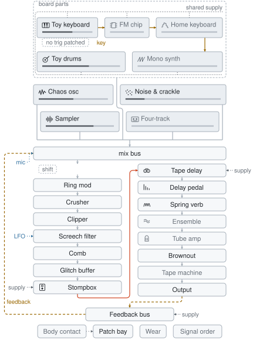

# How it works

The panel is a live drawing of the signal path. Clicking a box on the drawing
opens that box's controls.

## The signal path map

<picture>
  <source media="(prefers-color-scheme: dark)" srcset="../img/chain-dark.svg">
  
</picture>

`pnpm diagram` regenerates that image with the layout code the panel draws with
(`src/ui/chain-map.ts`). The code places the boxes and routes the wires with no
graph library. The live version redraws as you play: bend slots appear in the
order you patched them, dead stages grey out, and patch-bay wires are drawn over
the top as dotted lines from source to destination.

Click a node to open its controls. Click a wire for the patch bay, or a wire's
label for whatever it's clipped onto.

**The panel's map draws the stages on the board**, and the image above draws
every stage.

- A stage is on the board when its level or mix is up, or, for a stage with
  neither, once you move a control off stock. Mix bus and Output are always on
  it, and so is any stage a drawn wire ends at.
- **+ add a stage** under the map lists the rest. Picking one opens it, and
  opening a stage keeps it on the map. The tab keeps that list through a reload,
  and a new tab starts without it.
- **take off** in a stage's header turns its level or mix down and leaves its
  other knobs alone. A stage with neither goes back to stock.
- **random**, **hunt an edge**, **mutate** and **drift** change only the stages
  on the map.

**Six slots, eight bends.** You choose which six are on the board, and in what
order. The map draws the other two loose in the rack at the head of the chain,
dashed and soldered to nothing. Click the rack to reorder the slots, or click a
loose bend to open its controls.

The Plinky, the drum machine and Glint group their advanced controls under
headings that expand on demand.

- A heading shows how many controls are folded under it, or how many of those
  you've changed.
- A heading with a changed control opens automatically, so a fold never hides a
  setting you changed.
- Other controls on a panel appear once they have something to act on. A fault
  picks what happened to a wire, so it appears after a wire is cut.

Three of the chips have a row of **named cuts**, one-click presets that set the
three controls a bus fault needs together: which wire, what happened to it, how
deep. Pressing a cut sets all three, and the row underneath shows which controls
changed.

## Sources on one rail

Sources are boxes at the head of the path. Five of them share one power supply:
Plinky, the drum machine, Glint, Parlor and Growler are dies on one rail. The
map draws them inside a dashed frame with the dotted supply rail running past
every box. A battery box on the rail opens **Power supply**, and so does the
voltage lamp on each machine's deck. The **Starve** knob in that panel drags the
rail down, so the chips' pitch dives and the kit's tempo slows. A machine whose
**Supply** picks the second cells or the bench drops no tap onto the rail.

- **The key line:** the toy's gate line runs along the top row from the toy
  keyboard to Glint and Parlor, then drops onto Growler. All three play whatever
  note the toy strikes, from your keys, its tune or its arpeggio. The line
  dashes from the far end in as you cut jumpers, and it thickens while the toy
  and a machine on it are both sounding. A kit bridge thickens for a moment
  after each hit on its voice.
- **Jumpers:** each of the three has a **Plays Plinky’s notes** jumper. With it
  cut, the chip plays from its keybed and from any trigger bridge you patch
  across from the drums. Each bridge on the map reads `kick → FM`: the kit
  voice, then the machine it strikes. See [the trigger patch](USER-GUIDE.md) in
  the user guide.
- **In the panel:** the map puts the five on two rows, with the drums under the
  Plinky. The image above uses the same layout.

Three more sources, the chaos oscillator, the noise generator and the sampler,
share no rail. The mic has no source box. The map draws it as a wire that ends
on whichever of its seven solder points **Mic patch** selects.

Each box has a glyph for its machine and a meter for its fader level, and both
light while the machine is producing sound. The light comes from the same bus
taps as the desk's meters, so a box with its fader at three-quarters stays grey
when nothing has struck the chip.

## The mix bus

The **mix bus** is where every source connects. It opens like any other stage
and shows:

- every fader on one screen, each with a meter that reads what that channel puts
  on the bus, taken from the audio thread
- the bus meter underneath, read where the faders meet, ahead of the final
  output, so it shows which channel is eating the headroom

The meters show Glint silent at three-quarters fader because nothing on the toy
has struck a note for it to play, and the same reading leaves its box on the map
unlit.

**Bus drive** is the knob on the summing amp where all six sources meet. The amp
is unity gain and the first saturation stage ahead of any bend. The feedback
return enters the same bus, so a runaway feedback loop saturates in the same amp
as everything else.

## Real-time engine

The whole chain runs inside a single AudioWorklet `process()` call, so the
feedback loop is tight enough to squeal. Every feedback path saturates in-loop
by design, which holds runaway at the rails. A fixed safety tail (DC block, soft
clip, a limiter at −1 dBFS, and a NaN watchdog) means no combination of settings
can blow up the output.

Three pages go further:

- [dataflow.md](dataflow.md): how a block gets rendered across the main and
  audio threads, where the buses sit, and what runs per sample and what per
  block
- [optimizations.md](optimizations.md): what the engine costs, and what was
  tried and thrown away to keep it inside budget
- [Bends](BENDS.md): what each fault does to the circuit

## What is stored where

Signing in stores three things on your account:

- **Voices:** each one a name and the board hash from the address bar.
- **Recent sessions:** the board you last had open, one per visit and the last
  eight. The app saves a session a few seconds after the board stops moving and
  once more when the tab is hidden. The home page offers one back on another
  machine. When you resume a session from the home page, the app keeps writing
  to it; any other visit starts a new one.
- **Setup:** the bench layout, the morph time and the remapped computer keys.
  The hook in `src/ui/useSyncedPrefs.ts` syncs it. Every change stamps a clock
  on this machine, and on sign-in the newer side wins.

Everything else stays in `localStorage` on the device where you set it, such as
MIDI knob and pad maps and whether the machines were running, because those
settings describe this machine. The undo walk describes this tab and goes when
the tab does.

Signed out, the app fetches none of the Firebase SDK, because the imports in
`src/ui/cloud.ts` are dynamic and gated on a localStorage hint that this browser
has signed in before.

bender shares a Firebase project with
[videoskillet.js](https://github.com/cmdcolin/videoskillet) and stores its data
under `benderUsers/{uid}`. The rules for that collection come from the
videoskillet repository's `firestore.rules`, and this repository has no rules
file.

The setup is stored under `prefs` in the same document. A change to `prefs`
needs the rules deployed first; a write the rules refuse logs an error to the
console and the setup stays on this machine. The write uses `mergeFields`,
because a plain merge joins nested maps and keeps keys the player removed.
