# User guide

Open the app and press keys. Everything else is something to try.

- **Play:** click the keys, or type. Letters are printed on them
- **Click a preset**, or hit **random**
- **Click a box on the map** to open its knobs
- **Turn Starve up** under Power supply while a chord rings
- **Hit share.** The link is the whole board

Each machine's panel opens on a drawing of its circuit. Press a box in a drawing
to open that part's controls.

## Plinky

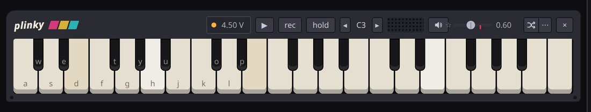

A toy keyboard chip on a battery that sags. One RC oscillator clocks a divider,
a ROM of tunes and the envelopes. Record a melody, hold a chord, turn on the
arpeggiator. The six effect buttons over the keys (laser, siren, ufo, bomb, gun,
bird) play one pass per press and repeat while held.

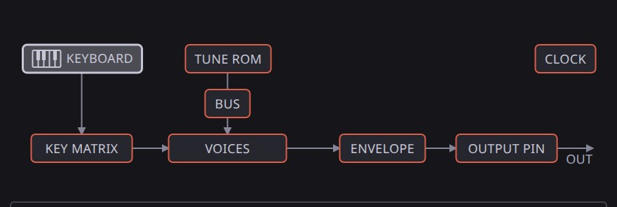

## Clatter

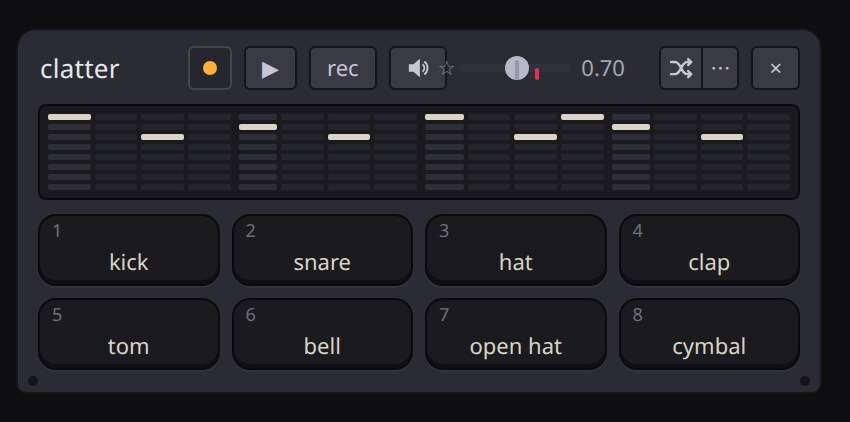

A toy drum box. A step counter reads a pattern memory and fires analog voices.
Tap pads, tap the tempo, or draw steps in the strip.

The button over the last column swaps each row's length for the bars it plays,
after a groovebox's trig conditions: **3:4** plays the third bar of every four,
**!4:4** every bar but the fourth. The button lights while any row has one.

Two rows under the grid work like a tracker's effect columns:

- **ratchet** fires a step ×2 to ×8 inside itself. **Ratchet ramp** fades the
  repeats out or swells them in
- **nudge** lands a step late, in twelfths of the step. A nudged ratchet fits
  its repeats into what is left
- **event** puts a fault on the whole board for one step: **c** cuts the output,
  **d** drops the cells' contact so the shared rail sags, **b** brakes the mix
  to a stop, **f** repeats the step's first half and **r** pulls the power. A
  reboot on the shared cells restarts the kit's bar too. A run of one letter
  plays as one fault: four **b** in a row brake over the whole beat, and four
  **f** roll faster and faster. The button at the end of the row sets how often
  the row fires: **4:4** fires on the fourth bar of every four

The event row's five faults also play live from the keyboard while the kit runs.
Hold a key and the fault starts on the kit's next step and lasts until you let
go:

| key | throw   | fault                                       |
| --- | ------- | ------------------------------------------- |
| `.` | knife   | the whole board cut                         |
| `;` | unplug  | the cells off the board; held long, reboots |
| `/` | stop    | the whole mix braked to a stop over a beat  |
| `i` | stutter | the whole mix rolled faster and faster      |
| `r` | reboot  | the power pulled on every step              |

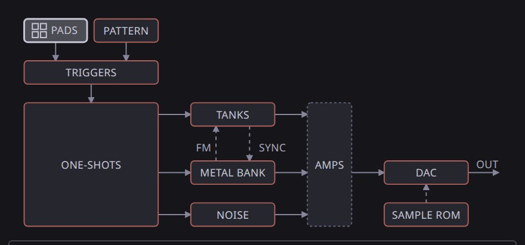

## More machines

Add them from the **Add instrument** menu.

### Glint

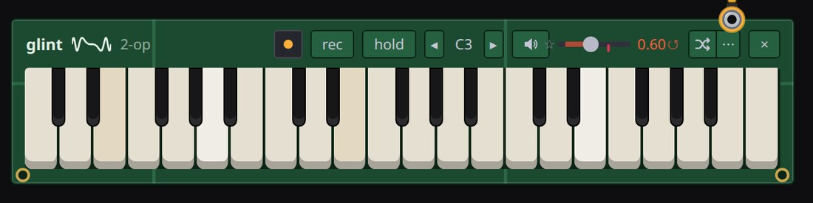

A two-operator, four-voice FM chip. A processor sets it up a byte at a time over
a bus, so a wrong byte stays wrong until the processor writes that register
again. The row of buttons over its keys runs the effect ROM's scripts (bird,
surf, wind and seven more) while held.

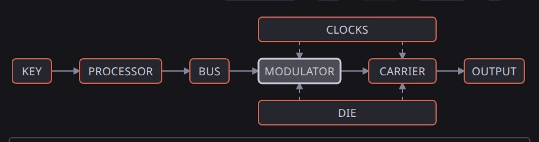

### Parlor

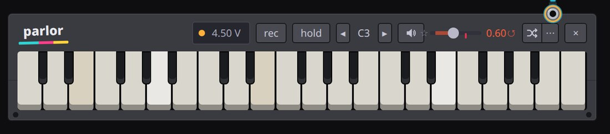

An eight-bit sampling home keyboard. A ROM holds one short recording per voice,
and a counter walks it at the rate each note asks for.

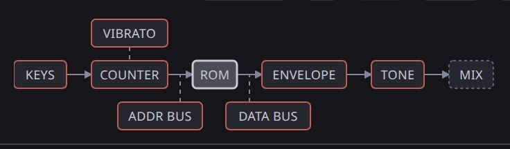

### Growler

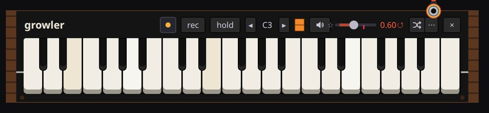

A Model D-style monosynth card. Three oscillators with hard sync feed a
four-pole transistor ladder filter that self-oscillates.

**Kit sync** on its melody memory steps the bass line on Clatter's counter, so
swing, a slipping clock or a cleared counter moves the bass with the drums.

The **acc** and **slide** rows under its piano roll make it an acid line. An
accented step hits louder and kicks the cutoff, and accents close together
climb, higher with more **Emphasis**. A slide holds the gate into the next note
and glides there with no new attack.

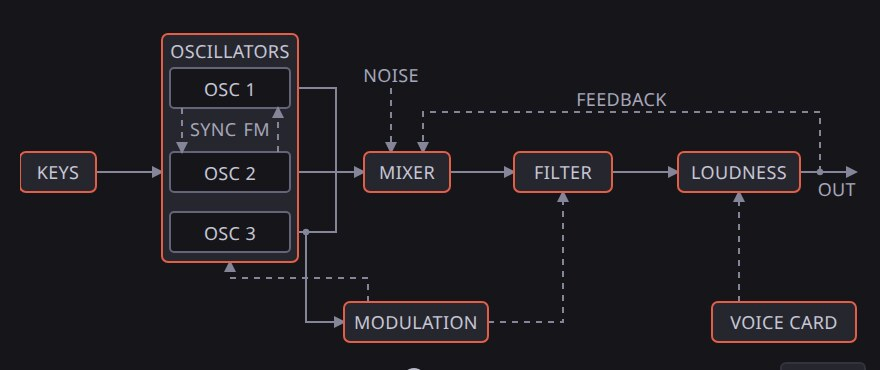

### Four-track

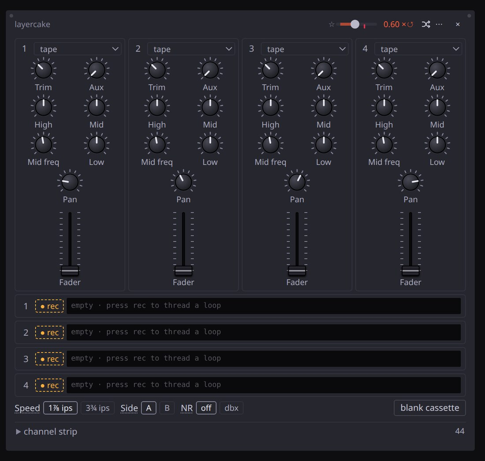

A cassette four-track. Four tape loops of different lengths run behind a desk
with EQ and an aux send, and the desk squeals with nothing plugged in.

### Spool

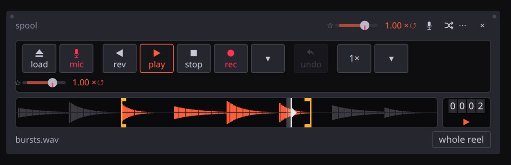

A tape loop that records onto itself. Whatever is on the reel plays through the
whole board, and the record head lays the board's output back down at the play
head, so each lap goes through every bend, pedal and tape machine again.

Put a tape on:

- **Drop an audio file** anywhere on the page
- **load** pulls a random tape off an archive.org shelf: 78s, numbers stations,
  old-time radio, NASA audio or spoken word. The drawer also searches
  archive.org
- **rec** with nothing loaded threads a blank reel. Press it again to close the
  loop at the length you played

Play it:

- **rev**, **play** and **stop** run the transport
- **The speed key** steps through ¼, ½, ¾, 1 and 2×. The arrow beside it opens a
  knob from 4× reverse through a stop to 4× forward
- **Drag the two markers** on the reel to loop one bar of a long recording.
  Pinch them together and the loop sounds as a pitch. **whole reel** puts them
  back at the ends
- **Drag the tape** to move the head. The counter beside the reel reads whole
  seconds into it
- **Restarts the file on** and **Ending: one-shot** in the panel turn the file
  into a seventh drum voice, struck by a kit voice, a key or a shout in the mic

Record over it:

- **rec** overdubs the board's output onto the reel. **undo** takes the last
  overdub back off, and nothing restores anything older
- **The arrow beside rec** opens the record head's knobs
- **Erase** all the way up replaces each lap with the next, a delay the length
  of the reel. All the way down, the laps pile up
- **Wear** takes a little more top end off every lap, and **Hiss** lays a new
  layer of noise down each time round
- **Hold** turns the write level up by what each lap lost, so the loop stays at
  its level
- **A bend in the path** changes the loop a little more on every pass

Wire it in:

- **Mic into → tape motor:** the tape runs as fast as you are loud and stops in
  silence
- **The patch bay** reaches the capstan and both loop markers, to bend the
  reel's pitch or slide the loop window along the recording
- **Parlor's sampled voice** plays the reel across its keys, with the loop
  markers as its loop

### Mic

Your microphone, soldered into the board. **Mic into** on the bench bar, or the
mic cap on a machine, picks the jack.

## The trigger patch

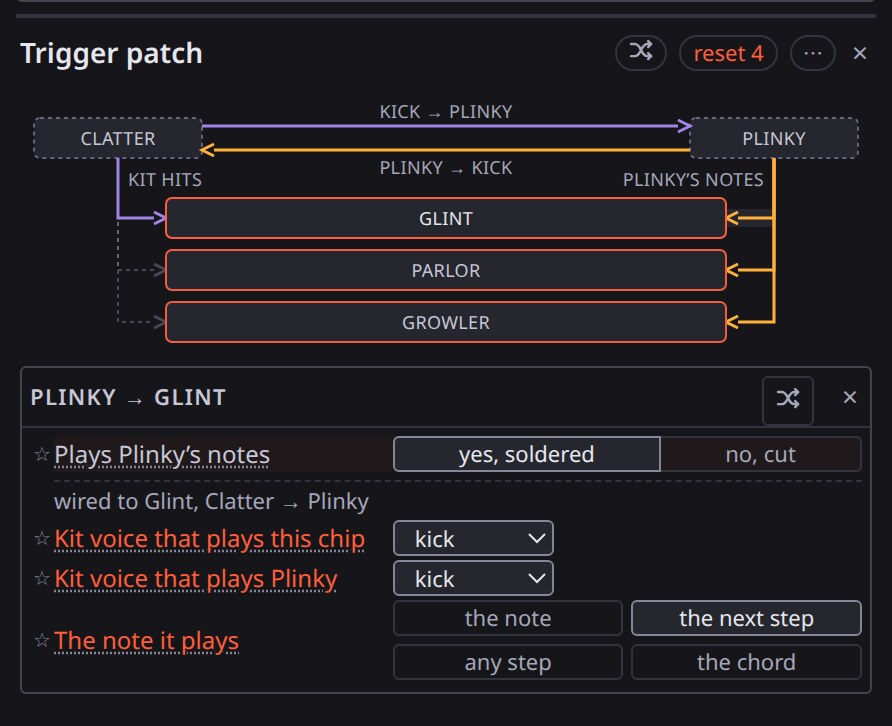

Jumper wires between machines: Plinky's gate line and Clatter's trigger lines
are bare traces, and a jumper bridges one onto another machine's key input. Drum
hits play the keys, keys fire the drums, and the FM chip, Parlor and Growler
listen to both.

The bench draws the same wires as patch cables down a gutter beside the
keyboards:

- **GATE** runs from a jack on Plinky's right edge to each keyboard's top jack
- **TRIG** runs from a voice's jack on top of Clatter to a keyboard's lower jack
- Press a jack to plug it in or pull it out; drag a cable's end to repatch it

## Power supply

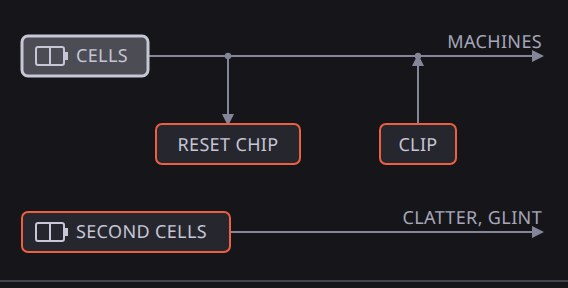

One battery rail runs Plinky, Clatter, Glint, Parlor and Growler, so a sag drops
the pitch of all five and slows the kit. A reset chip reboots the chips at a
voltage you set, or jams one.

- **Supply** on each machine's panel moves it off the shared cells
- **Second cells:** a separate set with its own knobs and watchdog
- **Bench supply:** a stiff rail that never sags or reboots

## Bend it

- **Starve** drags the shared battery rail down
- **Clip chatter** drags a paperclip across the pads
- **Letter keys** switch on sixteen dealt bends. The envelope picker beside
  them sets how a held key moves: **snap**, **swell**, **riser** (climbs over
  four bars, drops when you let go), **pluck** or **wobble** (pulses on the
  eighths)
- **Knife on the bus** cuts, grounds or bridges a wire inside a chip
- **Pedals:** add tape echo, spring reverb, chorus, a tube amp or dirt boxes
  from the **Add pedal** menu

**+ mod** wires an LFO to any control. The patch bay holds four wires from a
source to a knob. **LFO sync** runs the LFO in bars or note values of the kit's
tempo and restarts each cycle on the beat it belongs to.

**Step lanes** under the bay are two rows of sixteen values, **lane A** and
**lane B**, each with its own length. A wire off a lane sends the value on the
step the kit stands on, so one step can starve the rail, the next can open the
crusher, and the one after can leave both alone.

**Phrase** is a source that moves over 1 to 32 bars of the kit:

- **Rise** climbs and drops back on the downbeat; **build** saves its climb for
  the last bars
- **Fall**, **swell**, **stairs** (a notch a bar) and a slow **wave** cover the
  other moves
- Wire the phrase onto another wire's depth, and a fast LFO on that wire grows
  over the phrase

## Pedals and tape

- **Gnash:** six dirt-box circuits: screamer, rat, muff, germanium, octave, gate
- **Wraith:** a tape echo. A motor-driven capstan pulls a five-second loop past
  three play heads. **Time sync** sets the echo from the kit's tempo
- **Ricochet:** a delay pedal with a clean mode, a bucket-brigade mode, reverse
  and hold
- **Boing:** a spring reverb tank that crashes when you kick it
- **Chorale:** a bucket-brigade chorus, string ensemble, dimension and vibrato
- **Ember:** a tube amp with Fender and Marshall tone stacks, a push-pull power
  stage that sags, and a speaker
- **Feedback bus:** the output fed back in, as a mixer with nothing plugged in
  squeals
- **Tape machine:** the whole board printed to open reel, cassette or
  microcassette, with Dolby B or dbx, wow, flutter and shed oxide
- **Brownout:** the mains failing, with sag, dropouts, crackle and hum
- **Varispeed:** slows the whole board, tempo and pitch together, as the motor
  of a deck winds down

## Keep it

- **Wav export** with stems
- **Share** copies a link to the board
- **Sign in** to save named voices
- **On a phone,** the simple version swipes and tilts to bend
