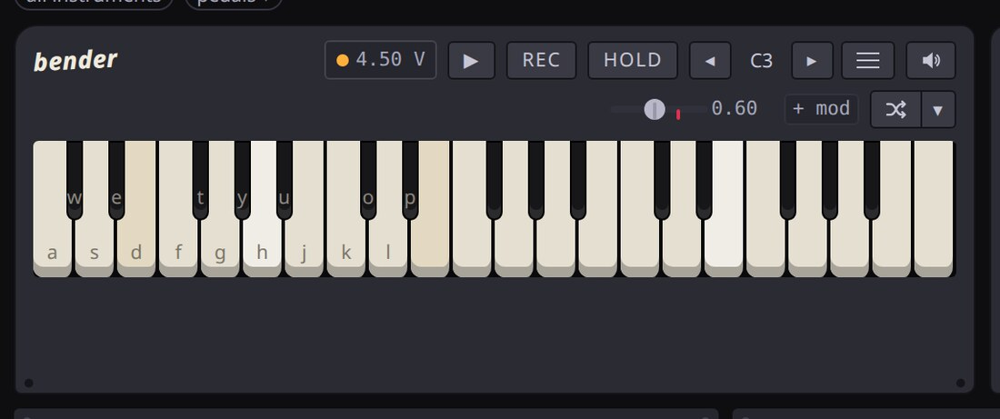
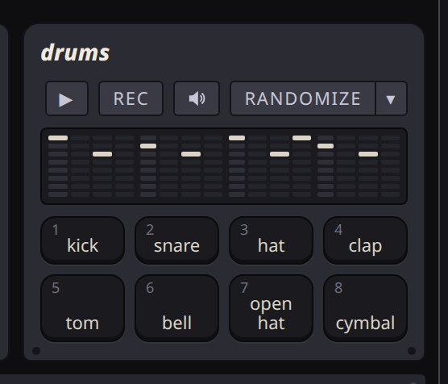
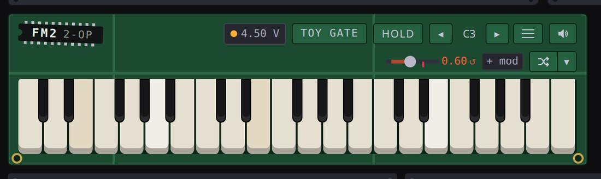
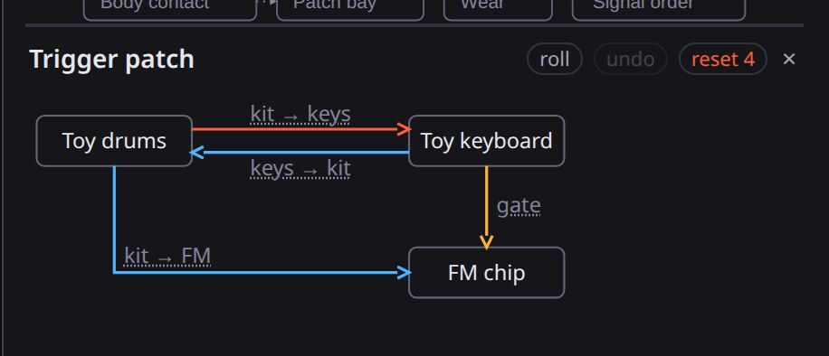
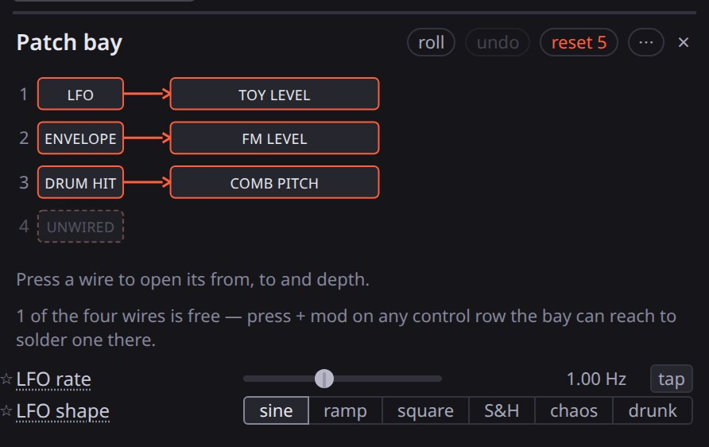
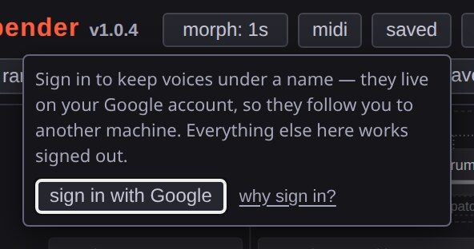

# User guide

## Playing the keyboard

- Three octaves from C3 on the on-screen board; `z`/`x` shift two octaves.
- Letters print on the sixteen keys under your typing hand.
- **Remap keys** from ☰ → **computer keys**, a keybed's drawer or the bend
  board.
- **Hold** latches every key you touch; alt-click pins one key.
- Keys light accent for your hand and amber for the toy playing itself.
- **Tone** picks 1/2, 1/4, 1/8 or 1/16 pulse width.

## Melody memory

- **Rec** on the deck, or **record** on the piano roll, writes every key you
  play to the step you heard.
- The memory is the 19th entry on **Tune**, after the 18 ROM songs.
- **Memory rate** sets its speed.
- **Show piano roll** draws it: click to place, drag to draw a run, shift-click
  to hold.
- 32 steps, with its own loop length.
- Undo tracks it, the shared link carries it, and random rolls leave it alone.

## Auto bass-chord

- Bass on the beat, chord stab on the offbeat.
- Follows the melody's step clock and the tune's chord.
- Starving or dragging the chip's clock takes the backing band with it.

## Arpeggiator

- **Arpeggio** modes: **up**, **down**, **up-down**, **random**, **as played**.
- **Hold** latches the chord.
- **Arp rate** sets notes a second; **Arp range** sets the octaves.
- **Arp sync** counts off the kit, from quarters to sixty-fourths.
- Plays Glint through the gate line.
- **Keys fire kit** turns it into a drum pattern.

## Kit sync

- **Kit sync** locks the tune's step to the drum machine's clock.
- Pick **sixteenths**, **eighths** or **quarters** per step.
- Reaches the melody, both memory lanes and the auto bass-chord.
- **Lock** beside **Clock** matches the crystal to the kit once.

## Key lock

- **Key lock** snaps every played note to a scale: **major**, **minor**,
  **dorian**, **mixolydian**, both **pentatonic**s, **blues**, **whole tone**.
- Applies to both keybeds, MIDI, the arpeggiator and the trigger patch's **any
  step**.
- Demo songs and the melody memory ignore it.

## The drum machine

- Sixteen steps, eight voices: **kick**, **snare**, **hat**, **clap**, **tom**,
  **cowbell**, **open hat**, **cymbal**.
- An accent row under the grid.
- Ten factory patterns.
- **Tempo** with a **tap** button; **Swing**.
- **Tune**, **Decay** and **Ring** shape the whole kit.
- **Kit** switches to the sampled kit: the kit recorded through its own
  circuits, with **ROM clock** setting the read speed.
- Metal voices share one oscillator bank: **Bank spread**, **Bank starve**,
  **Bank gate**, **Bank FM**, **Bank sync**, **Metal**, **Cymbal tone**.
- More bends: **Sweep**, **Choke**, **Tank coupling**, **Ring trigger**,
  **Counter reset**, **Pattern loop**, **Voice slot**, **Pulse sharing**,
  **Trigger load**, **DAC reference**, **Clap gap**, **Clap bursts**. See
  [Bends](BENDS.md).
- Drag across the grid to draw a run.
- Shift-click a step to set a row's own length, for polymeter.
- A second click makes a step a dice step that fires at **Chance**.
- **Roll**, **Vary**, **Turnaround**, **Shift** and **Half**/**Double** rewrite
  the grid.
- The **echo** row throws hits into the tape delay; **Throw** lights the last
  snare.
- Row names preview the voice.
- Number keys `1`–`8` play the kit.

- Eight rubber pads, **▶**, **rec** and a small copy of the pattern.
- **Rec** writes hits to the nearest step and allows for output latency.

## Glint

- FM chip with no sequencer; plays whatever the toy's gate line strikes.
- **Kit voice that plays this chip** wires a kit voice onto the gate line.
- One computer keyboard, three keybeds: tick **computer keyboard plays this
  bed**.
- A MIDI controller plays the toy unless you aim it elsewhere. See
  [MIDI](MIDI.md).
- **Voice** picks one of eight patches.
- **Brightness** and **Feedback** shape the modulator.
- **Note length** decides when triggered notes stop.
- **Level**, **Brightness** and **Feedback** run past the chip's range; a red
  tick marks it.
- **Drive** pushes the output stage up to 36 dB.
- **Clock** drags the chip's crystal; **lock** matches the toy's.
- **CPU clock** drags the processor's.
- **Vibrato**: **tremolo**, **vibrato** or **both**.
- **Rhythm** re-taps two channels onto a ROM kit; **Noise blob** wires the shift
  register onto the sine table.
- **Mod ratio**, **Car ratio**, **Mod decay**.
- Knife bends: **FM cut depth**, **FM noise blob**, **FM bright**, **Patch
  line**, **Patch data line**, **DAC slot**, **Slot slip**, **Allocator**,
  **Cold boot**, **Log adder**.

## Parlor

- Eight-bit sampling keyboard: pads, strings, choirs, bells.
- **Level** brings up its bed; **Plays Plinky's notes** jumper is out by
  default.
- Signal-path drawing; press a box to open its knobs.
- **Voice** picks the recording.
- **Envelope**: _piano_, _organ_, _pad_, _chime_.
- **Release**, **Chord memory**.
- **Tone** sets the reconstruction filter's grit.
- **ROM clock** drags pitch and aliasing together.
- **Sampled** plays the tape loop across the keys.
- Knife bends: **Address line** and **Data line**.

## Growler

- Three-oscillator monosynth with a transistor ladder filter.
- **Level** brings up its bed; the jumper plays the toy's tune two octaves down.
- **Cutoff**, **Emphasis** (self-oscillates past 0.95), **Contour amount**,
  **Drive**, **Glide**.
- **Gate** sets note length for the toy and kit lines.
- **Kit voice that plays this synth** restarts the last note on a kit hit.
- **Oscillators**: waveforms, footages, tuning, hard or soft sync, **Osc 2
  sweep**, **Lin FM**, **Osc 3 control** as LFO.
- **Mixer**: levels, noise and **Feedback**.
- **Leaky VCA** drones with no key down.
- MIDI _bass split_ puts the synth under the split point.

### Second melody memory

- 32 steps, one note a step, no chords.
- **Show piano roll** draws it; **Plays on** aims it at Growler, Glint or
  Parlor.
- **Draw:** click a step, drag a line, shift-click to hold.
- **Record:** **rec** on a bed aims the memory there and runs the song.
- **Play:** **loop** sets its length; **Memory rate** sets its speed.
- **Supply:** the toy's rail slows it, and a reboot restarts it.
- Rides in the link and undo; random rolls leave it alone.

## Pedals and levels on the bench

- **Level** on every instrument's face; Glint, Parlor, Growler, Spool and
  Layercake appear when raised.
- Loading a tape brings up the tape loop's face.
- **Open mic** is in the Mic stage's panel.
- **Add instrument** lists instruments not on the bench, such as "Glint (FM
  synth)".
- A face's close cap takes its stage off the board.
- **Add pedal** lists the six pedals in signal order.
- Each pedal face has a **bypass** footswitch and its headline sliders.
- **⋯** opens the pedal's full panel.
- A bypassed pedal keeps its settings.

## The trigger patch

- **Kit fires keys:** a drum hit plays the keyboard. Notes: standing, **next
  step**, random step or chord tone.
- **Keys fire kit:** every note fires a drum voice. **The step** fires the
  sequencer's column.
- Both ways together make the machines play each other.
- **Plays Plinky's notes** is Glint's keyboard jumper.
- **Kit voice that plays this chip** turns a drum pattern into a riff.
- Every wire and the shared rail can be bent. See [Bends](BENDS.md).

## The four-track

- Four tape loops, each with its own length; silent until **Level** comes up.
- Per channel: **in** (**tape**, **board**, **mic**, **aux**), **Trim**,
  **Aux**, **High**, **Mid**, **Mid freq**, **Low**, **Pan**, **Fader**.
- Drag a knob or use arrow keys; double-click resets.
- **Rec** lays a channel onto its loop; each pass records over the last.
- Loop the board: **in** to **board**, **rec**, raise **Level**.
- **No-input mixer:** the desk feeds itself through the aux return.
- **Squeal through the echo:** adds the delay pedal to the loop.
- **Channel strip** diagram: press a box to open its knobs.
- **The transport:** tape level, hiss, wow, flutter, wear, batteries.
- **Speed**, **Side**, **NR**, **Pitch**, **blank cassette**.

## Turning knobs

- **Type a value:** click the reading; `8k` and `250ms` work.
- **Fine moves:** shift-drag at a tenth of the speed; scroll wheel steps.
- **Back to stock:** ↺ or double-click the track.
- **Pin a knob:** ☆ puts it on the **pinned** strip.
- **Open a machine's panel:** click its name plate.
- **▴ fold the map** gives the knobs room.

## Presets and rolls

- Click a preset to load the board.
- Drag a preset sideways to morph part of the way.
- **Find** narrows presets by name, description or stage.
- **Random**, **hunt an edge**, **mutate** and **drift** change only stages on
  the map.
- **+ add a stage** puts a stage on the map.
- Rolls land delay and glitch times on beat divisions.
- Rolls stay inside a control's red-tick range; **wreck it**, **slam** and **on
  the edge** use the whole track.
- Every stage has its own **roll**, **undo** and **reset**.
- Whole-board rolls: **rewire**, **one bend**, **wreck it**, **slam**, **on the
  edge**, **let it age**, **patch**, **cascade**.
- **Dub** builds a dub desk around what is playing.
- **Hunt** tries six boards and keeps the loudest that doesn't bury the limiter.
- **Hunt a tail** keeps the dub board that rings longest.
- **Drift** moves toward a new setting every fifteen seconds; **⟲ 10s** goes
  back.
- **Share** copies a link to the board.

- **+ mod** beside any control solders an LFO wire onto it.
- The wire folds out under the row; **× unplug** removes it.

## Demo songs

- 18 ROM tunes: four factory demos, eight public-domain pieces, six slower minor
  and modal ones.
- Your melody memory is the 19th.

## Throws

- The bend board draws the letter keys; a key pushes the board while held.
- Throws stay out of the link and undo.
- **Top two rows:** sixteen dealt bend keys.
- A four-track channel's **Trim**, **Low**, **Mid**, **High** and **Pan** deal
  only once its **Fader** and the desk's **Level** are up.
- **Bottom row:** **spin** (`c`), **dive** (`v`), **brake** (`b`), **crash**
  (`n`), **drop** (`m`), **crush** (`,`).
- `z`/`x` release every key and deal sixteen new ones.
- **Bend keys** toggle sends the letters to the bend board; a `?bend` link opens
  it on.
- Shift pins a key.
- Dealer modes: **tame**, **wild**, **wreck**, **swell**, **redeal every**.
- The kit's **bend** row fires the key with each step's number.
- A MIDI pad can hold a bend key. See [MIDI](MIDI.md).

## Playback and recording

- **Play demo song** and **play drums** run independently; `space` toggles both.
- **Record wav** captures the output as a 16-bit stereo file.
- **⟲ last 30s** saves the last half minute; **⟲ → reel** puts it on the tape
  loop.
- **Varispeed** (Output panel) slows pitch, tempo and tails together; **Motor
  weight** makes tape stops and spin-ups.
- A patch-bay wire can land on `deck speed`.
- **Master only** or **Master + stems**: toy, drums, Glint, chaos, noise, tape
  loop.
- Stems are dry, mono and taken at the mix bus; the master carries the mic and
  feedback return.
- Takes stream to disk: about 11 MB a minute for a master, 5.5 MB for a stem.

## Simple version

- [`/pocket/`](https://cmdcolin.github.io/bender/pocket/) is a phone-upright
  bender; ☰ opens it on the same board, **full app ↗** goes back.
- **▶** runs the tune and the kit.
- **● rec** records; the chip beside it shares the wav; **↶** undoes.
- Swipe the scope for the next preset; tabs sort presets by machine.
- Hold and drag the scope to bend; release puts the board back.
- Bend modes: **dub**, **starve**, **crush**, **glitch**.
- **Tilt** bends from the phone's lean.
- Tap a preset twice to set how far toward it the board goes.
- **Bends** lays out the sixteen bend keys as switches, with six throws.
- **Mix** sets machine levels and brings in the mic or a sample.
- Plays with an iPhone's ring switch on silent; installs from the home screen.

## The link is the board

- The `#` in the address carries every control off stock, the drum pattern and
  the melody. No server is involved.
- Short form: `#p=AJYBL1p-AgDABwCQAQDoBwF4`
- Long form, writable by hand, with control names from
  [features.md](features.md): `#set=chipStarve:0.8,dlyFb:0.6,drumKick:33825`
- Anything left out is stock, out-of-range values clamp and unknown names drop.
- Type a bare `#set=` to switch a tab to the long form.

## Signing in and saved voices

- A voice is a whole board under a name.
- Save with **save**, **ctrl+S** (**⌘S**) or the **saved** popover.
- Saving under a name already in the list overwrites that voice.

- Per voice: name to **recall** (shift-click overwrites), **↗** opens it, **⧉**
  copies a link, **×** deletes.
- Voices live on your Google account and follow you across machines.
- Only voices need an account.
- The [privacy page](https://cmdcolin.github.io/bender/privacy/) lists what the
  account holds.
- Signed in, the app mirrors the open board; **Continue where you left off** on
  the [home page](https://cmdcolin.github.io/bender/) offers it back.
- The home page lists voices with **Copy link**, **Rename** and **Delete**.
