# User guide

Open the app and press keys. Type the letters printed on them, or click.

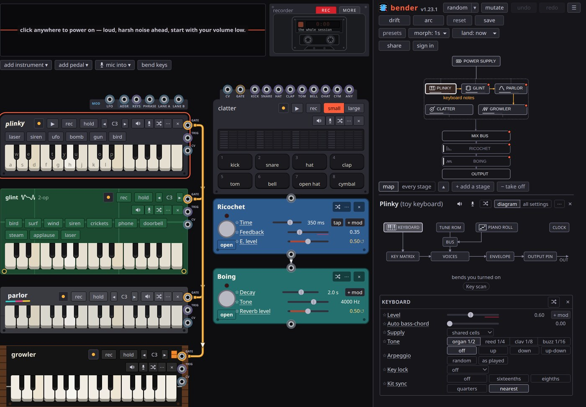

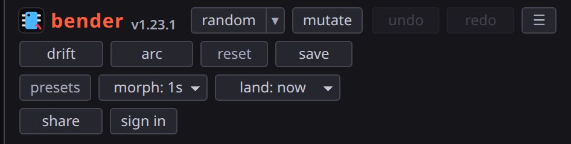

**random** rolls a board, **presets** lists the named ones, **share** copies a
link holding the whole board. **Space** runs the drums.

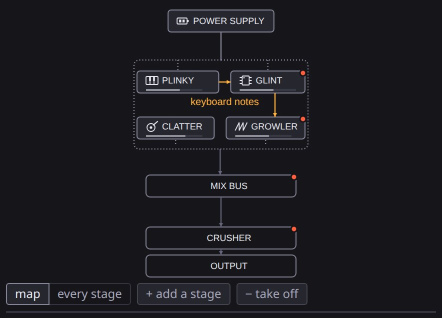

Click a box on the map to open its knobs. **+ add a stage** puts more on the
board.

## Plinky

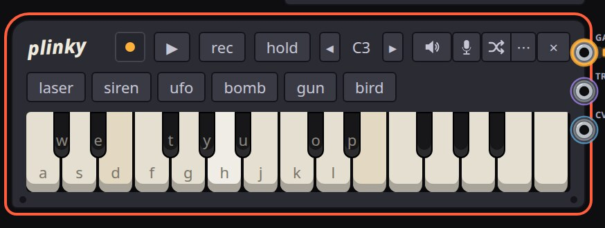

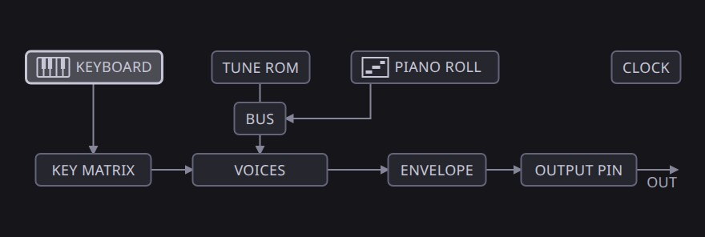

A toy keyboard chip on a battery. Press a box on the die to open that part.

## Clatter

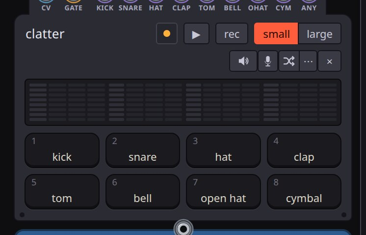

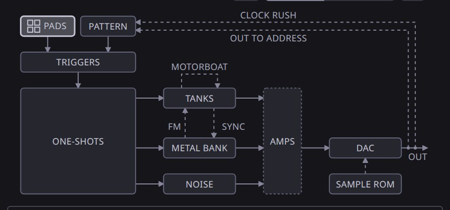

Tap pads, draw steps, press ▶. **Wander** lets the beat stray by itself.

## More machines

From **add instrument**.

### Glint, a two-operator FM chip

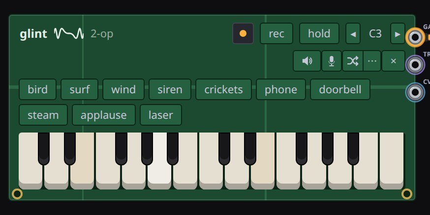

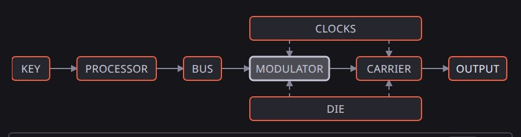

### Parlor, an eight-bit sampling keyboard

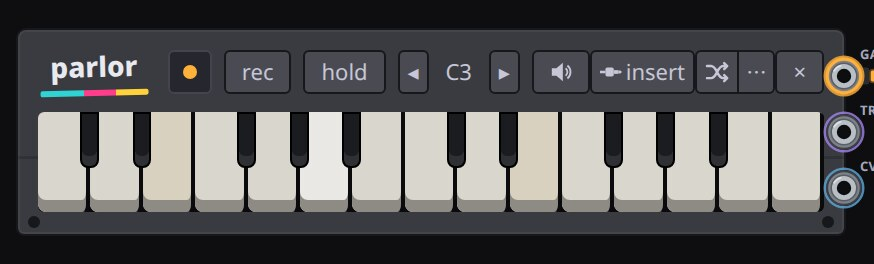

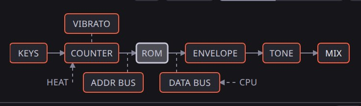

### Growler, a Model D-style monosynth

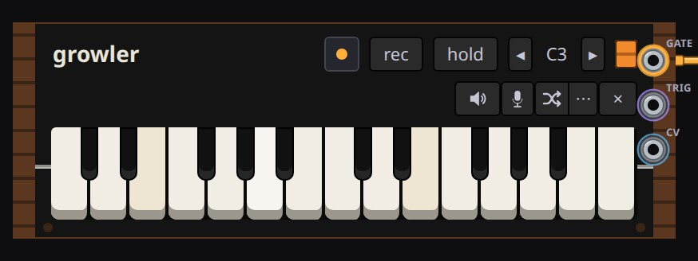

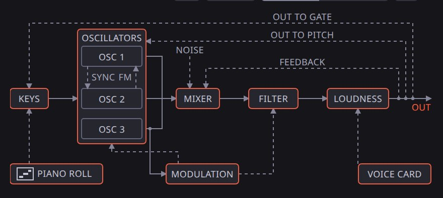

### Four-track

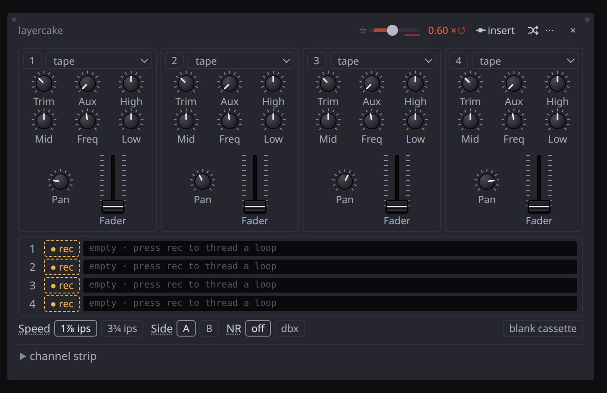

### Spool, a tape loop

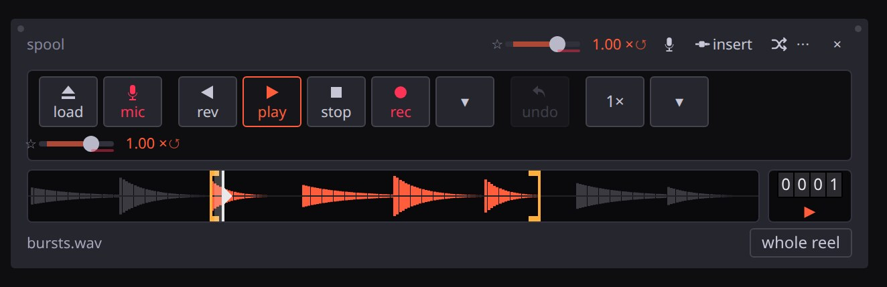

Drop an audio file on the page, or press **load** for a tape off archive.org.
**rec** records the board back onto the reel.

## Bend it

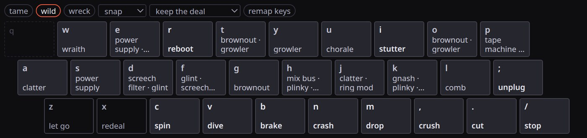

**bend keys** puts a bend on each letter. Hold one down.

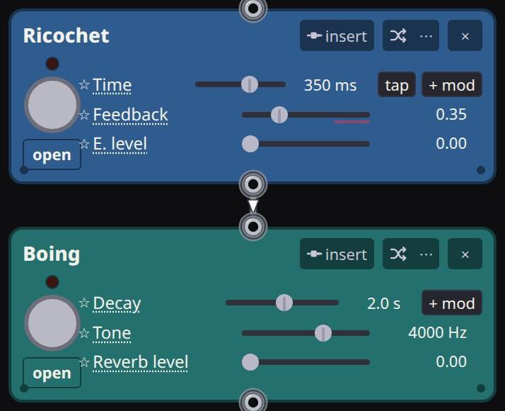

**add pedal** adds effects. Drag a cord's jack to reorder them.

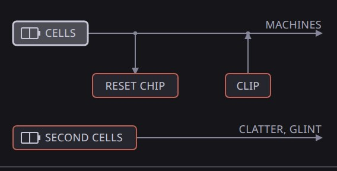

Turn **Starve** up while a chord rings.

## Patch it

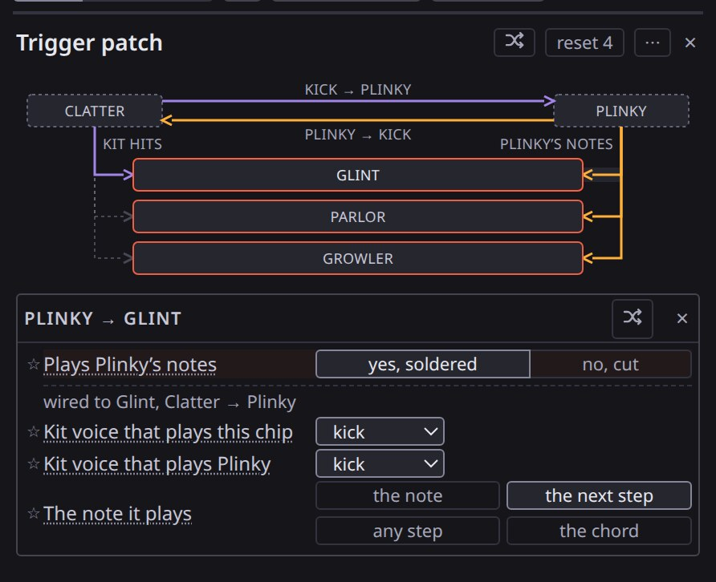

Amber cables carry notes, purple cables carry drum hits.

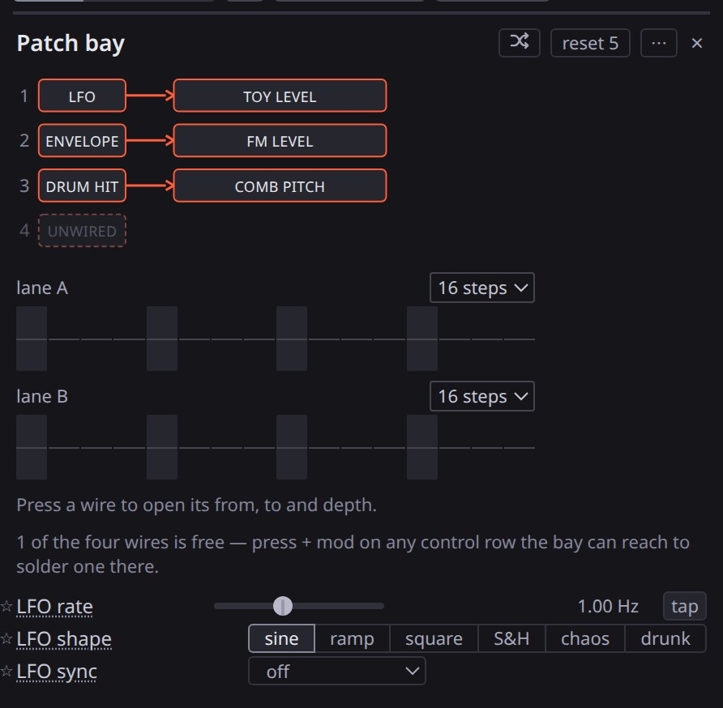

**+ mod** beside any knob wires an LFO to it.

## The arc

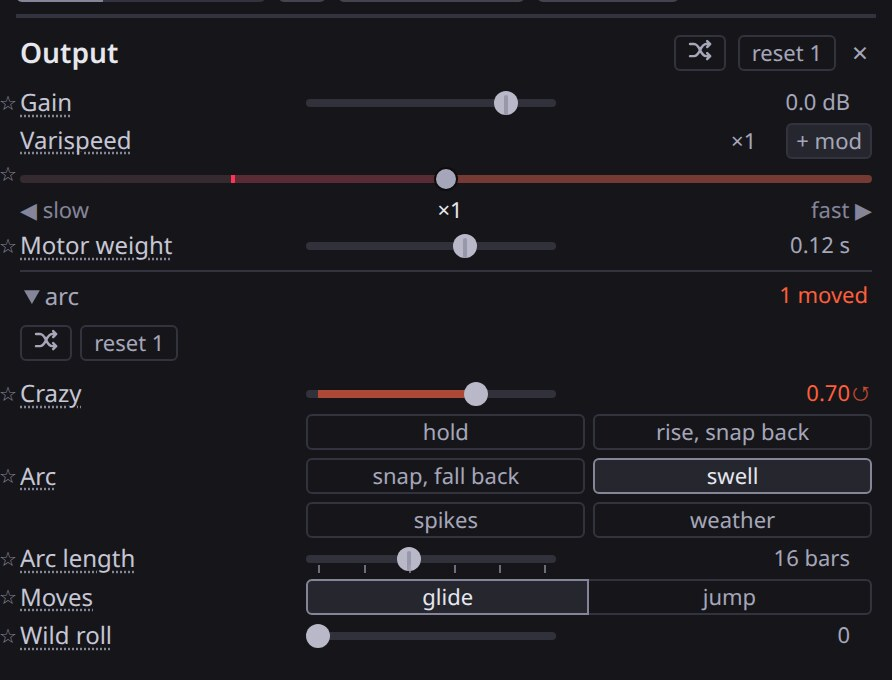

**arc** swings the board toward a wild twin of itself and back, over 4 to 128
bars.

## On a phone

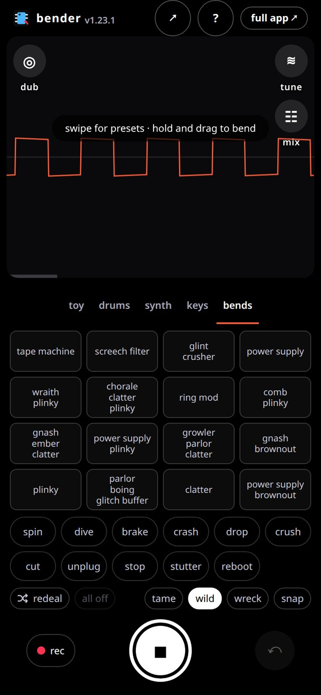

Swipe the scope for presets, hold and drag to bend.

## More

Every knob is in the
[feature list](https://github.com/cmdcolin/bender/blob/main/docs/features.md).
