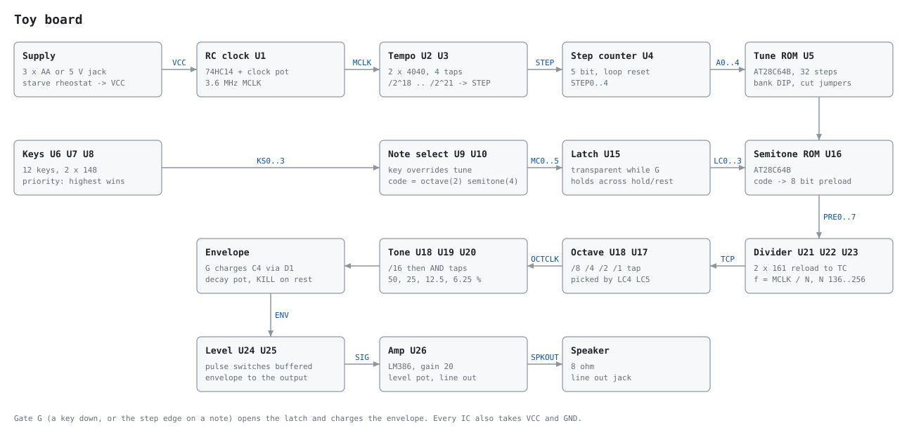

# Toy board

- **In:** 12 keys, 18 ROM tunes, a clock pot, a supply you can starve
- **Out:** an 8 ohm speaker and a line-out jack
- **State:** schematic and netlist, checked in simulation; layout and gerbers
  come next

The board hardwires the toy chip from `src/dsp/stages/toyChip.ts`: one RC clock
divided into pitch, tempo and envelope, a tune ROM, a key line and a speaker
amp. 131 parts, 26 ICs, all through-hole.

## Files

- `block.svg`, `sheet-*.svg`: the block diagram and five schematic sheets
- `toy.net`: KiCad netlist with stock footprints, for File > Import > Netlist
- `bom.csv`: parts list
- `rom/tunes.bin`: image for U5, the 18 app tunes at 32 steps each
- `rom/semitones.bin`: image for U16, the 12 divider preloads
- `rom/tunes.txt`: the DIP bank and tempo tap for each tune
- `board.ts`: the netlist. Every drawing and file above comes from it.
- `toy.test.ts`: gate-level simulation of the netlist

`pnpm toy` rewrites the generated files.

## How it sounds

- **Pitch:** `MCLK / (16 x N x 2^(3 - octave))`, with N from 136 to 256 off U16.
  Four octaves, A2 to G#6, each within 5 cents of equal temperament.
- **Tone:** a /16 counter ANDed into 50, 25, 12.5 or 6.25 percent pulses (SW7).
- **Tempo:** `MCLK / 2^18` to `2^21` (SW3), so 1.7 to 13.7 Hz at 3.6 MHz.
- **One clock:** pitch and tempo share MCLK, as in the app. RV1 starves the rail
  and everything sags together.
- **Note code:** 2 bits of octave, 4 of semitone. Semitone 12 is a rest and 13
  holds the note.
- **Keys:** one octave of 12, with SW6 choosing the octave. A key overrides the
  tune and the latch keeps its pitch after release.

## Bends on the board

| App control             | Board                                                                     |
| ----------------------- | ------------------------------------------------------------------------- |
| Clock, starve           | RV2, RV1                                                                  |
| Knife on the data bus   | cut or bridge SJ6-SJ11                                                    |
| Knife on the address    | cut or bridge SJ1-SJ5                                                     |
| Tune bank               | SW5                                                                       |
| Loop from / to          | SW4 wires a data line onto the counter reset                              |
| Supply                  | SW2 picks cells or the 5 V jack                                           |
| Paperclip, pot on a pin | pads on MCLK, CLK_RC, STEP, G, KANY, TCP, OCTCLK, PULSE, PRE0-7, ENV, SIG |

## Checks

`pnpm test hardware/toy` loads the ROM images into the netlist and runs it:

- the rule check finds no floating input, double driver or orphan net
- 27 notes divide MCLK by exactly the expected count
- the tone switch gives the four pulse widths
- all 18 tunes play in order, with the latch holding across holds and rests
- the tempo taps divide by 2^18 and 2^19
- a key overrides the tune, and the higher of two keys wins

A swapped wire in the mux fails 17 of these.

## Keeping it in step with the app

- **Tunes, tempos:** edit `src/dsp/stages/roms.ts` as usual, then run `pnpm toy`
  to rebuild the ROM images.
- **Circuit changes:** the board does not read `toyChip.ts`. Edit `board.ts`,
  run `pnpm toy`, and add a test beside the matching one in `toy.test.ts`.
- **Check:** `pnpm test hardware/toy` fails when
  - a generated file is older than `board.ts` or `roms.ts`
  - the app's address, data or bank line counts differ from the board's
  - a tune no longer fits the banks, steps or four octaves

## Not done

- **Gerbers:** none. Layout needs KiCad, which this machine lacks, and a board
  should go through DRC before fab. `toy.net` has not been imported yet.
- **Analog:** the clock, envelope, level stage and amp are unsimulated, and
  their values are first-pass. Trim RV2 until key A of octave 2 reads 440 Hz.
- **Delays:** the simulation has none. A preload that changes near a clock edge
  can glitch one note.
- **Supply:** the EEPROMs want 4.5 V or more. Below that the ROM misreads, which
  is a bend here.
- **Missing from the app's chip:** four key voices, arpeggiator, PWM volume,
  stacked chips and key ghosting.
- **Footprints:** stock KiCad names, unchecked. SW3 and SW4 are pin headers with
  a wire jumper.
